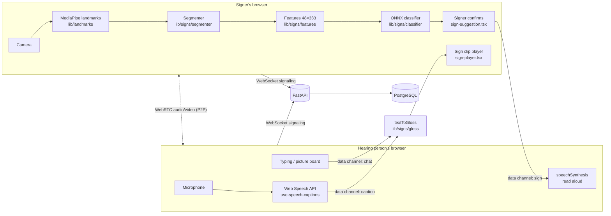
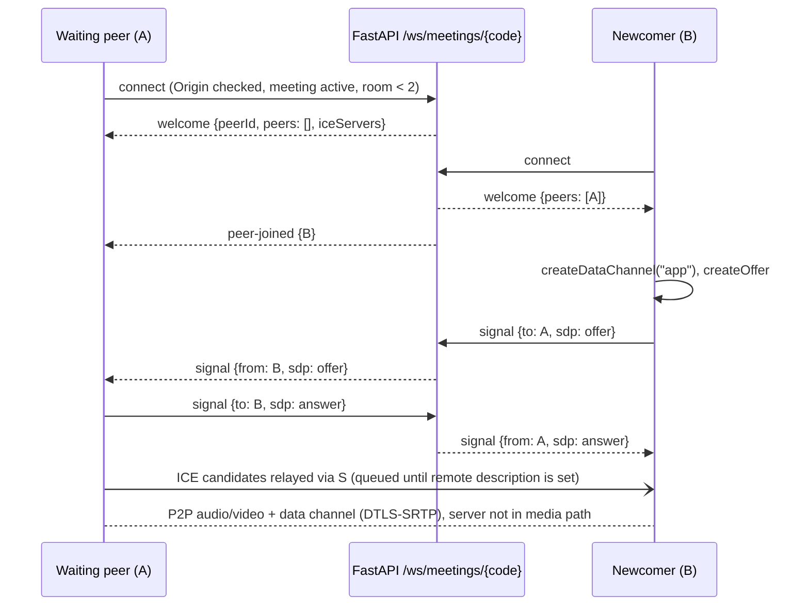
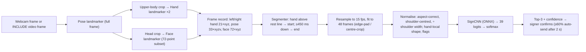
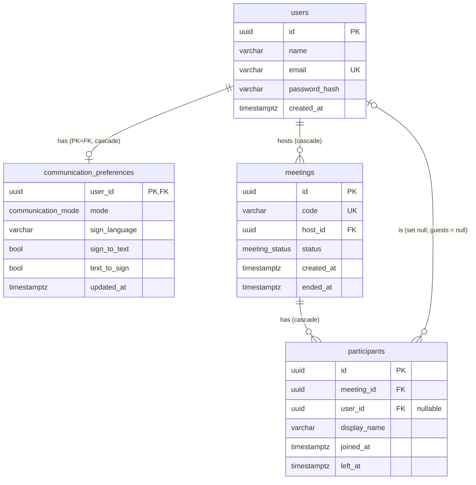
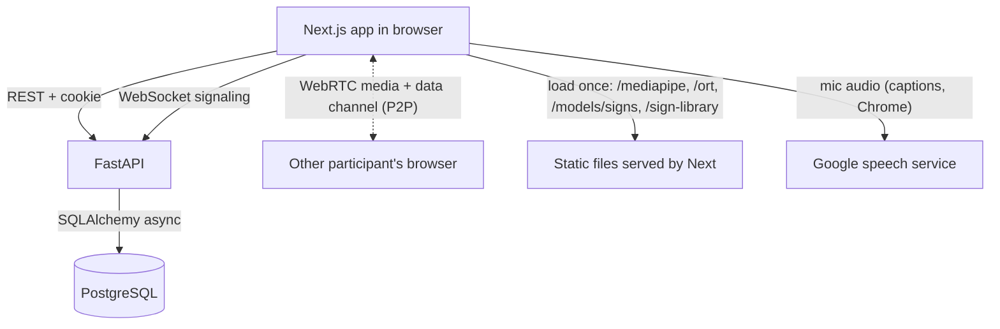
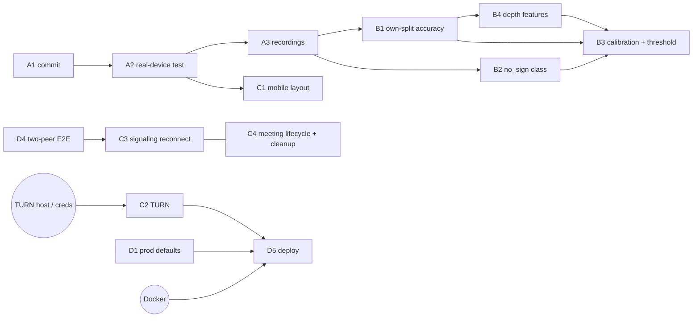

# SignSense 2.0 — Project Progress Report

**Audit date:** 2026-10-20 · **Repository:** `D:\signsense_2.0` · **Development period audited:** 2026-10-06 → 2026-10-20
**Method:** the repository, database, model files and datasets were inspected directly, and every check that could run safely was run (section 22). Nothing here comes only from plans or earlier conversation; claims that could not be checked are labelled.

**Revision 2 (same day):** every major claim was cross-checked again against the repository and re-run where possible; corrections are listed in **section 0** and applied in place.

**Revision 7 (2026-10-29):** live 3D Saathi in calls (rigged GLB, three.js), received signs and text performed by Saathi. See **section R7**.

**Revision 6 (2026-10-28):** Milestone 1 — UI/UX pass across all pages, the 931-clip retrain (run, compared, not promoted), practice-page warm-up. See **section R6**.

**Revision 5 (2026-10-25, later):** full website and UI/UX transformation, practice page moved onto the call's recognition pipeline, security and deployment hardening. See **section R5**; it supersedes older sections where they differ.

**Revision 4 (2026-10-25):** live sign recognition in calls was audited, hardened and verified end to end with a simulated camera. See **section R4**; it supersedes R3 where they differ.

**Revision 3 (2026-10-21):** results of the autonomous development phase: new model with unknown-sign rejection, UI/UX redesign, call reliability and security work. See **section R3**. Where R3 conflicts with sections 0–33 (written 2026-10-20), **R3 is current**.

### Status legend (used throughout)

| Label | Meaning |
|---|---|
| ✅ **COMPLETE AND VERIFIED** | Implemented and exercised at runtime: automated tests, a real browser session, or the user's own device (the evidence column says which). |
| 🔵 **VERIFIED WITH TEST INPUT ONLY** | Exercised end to end in a real browser, but with a *substitute* camera (dev test pattern `?fake=1` or an INCLUDE video clip `?fakevideo=`) because the audit browser has no webcam or microphone. Not yet confirmed with a real person and camera. |
| 🟡 **IMPLEMENTED — NOT RUNTIME VERIFIED** | The code exists and type-checks/builds, but its behaviour has never been observed at runtime. |
| 🟠 **PARTIALLY IMPLEMENTED** | Works, but with an important missing piece. |
| ⬜ **UI ONLY / MOCKED** | Interface present, no real behaviour behind it. |
| ❌ **NOT IMPLEMENTED** | No code. |
| ⛔ **BLOCKED** | Can't proceed without something external (data, hardware, a person, credentials). |
| ❓ **UNKNOWN — NEEDS VERIFICATION** | Could not be established from the evidence available. |

**Verification environment used in this audit:** Windows 11, Chrome-based in-app browser (no camera, microphone or speaker access; rejects self-signed TLS), the user's MSI laptop with an RTX 4060 Laptop GPU (8 GB), PostgreSQL 17.11 locally, Node 24.13.1, Python 3.11.9.

---

## R7. Update — 2026-10-29: live 3D Saathi in calls

Details, protocol, fallbacks and how to add signs: **`docs/SAATHI_3D_LIVE.md`**.

| Level | Status |
|---|---|
| Rendering integration (three.js 0.186.1 + @react-three/fiber 9.8.2, new dependencies) | ✅ implemented; code-split (not in the call page's initial JS — verified in the build) |
| Rigged character | ✅ built by script (`ml/blender/saathi_rig.py`, Blender 4.5): skeleton with clavicles, arms, wrists, 5×3 finger bones per hand, head, brows, eyes, mouth; Saathi's parts rigidly attached (no skin deformation) |
| Animations imported and playable | ✅ 39 clips in `sign-library/saathi-rig/saathi.glb` (3.6 MB), retargeted from the recorded landmark motion |
| Mapped to supported signs | ✅ every recogniser label → clip; validated by `scripts/saathi-rig.test.mjs` |
| Validated for sign correctness | ⚠️ proxy only — the app's recogniser reads 35/39 rendered clips as the intended sign first (17 auto-accepted, 0 wrong). **Not reviewed by Deaf signers.** |
| Live call integration | 🔵 tested in automated two-browser calls (recorded clip as camera): `npm run check:saathi-call` 7/7 |
| Physical devices / real users | ❌ not done |

- **Flow:** recognised sign → existing data-channel message (`gloss` = model label; protocol unchanged) →
  recipient validates the id against the registry → Saathi performs the clip locally (no video sent; the recipient
  runs no recognition). Typed/spoken text → existing gloss mapping → clips word by word; words without a sign stay
  text and are marked. Replay, 0.5× / 0.75× / 1×. Personal ("My signs") and unknown ids are shown as text only.
- **Safeguards unchanged:** 95% + whole-clip agreement for auto-send; unsure signs still need the signer's tap
  (`check:recognition` 12/12 incl. `uncertain-needs-confirmation`).
- **Layout:** desktop — Saathi column above the conversation; phone — large stage between video and controls
  (both checked: no overlap with video or controls, no overflow).
- **Fallbacks:** 2D choice, no WebGL, model/manifest load failure, render error → the recorded/2D Saathi player;
  the call and messages continue (tested).
- **Rig quality fix found by measurement:** aiming fixed-length bones put the wrist 22 cm off for "telephone"
  (30/39 readable); placing joints and stretching the arm bones put it at 0 cm (35/39, 17 auto-accepted).
- **Checks:** tsc ✅, lint 0, `test:signs` 44/44, `check:features` 9/9, `check:journeys` 13/13,
  `check:recognition` 12/12, `check:saathi-call` 7/7, build ✅, backend 77, ml 16.
- **Not done / limitations:** Deaf-user review of the signs; real devices; skin deformation and richer facial
  expression; ISL grammar (word by word only). Pre-existing: `npm audit` reports advisories in `next` (critical)
  and shadcn tooling — not from three.js / R3F; upgrade separately.

---

## R6. Update — 2026-10-28: Milestone 1 (UI/UX transformation + ML baseline validation)

Status labels as in the legend above. **Implementation** = code exists; **automated** = tests/scripts in headless
Chrome or Python; **simulated camera** = a recorded clip played as the webcam; **physical webcam** = a real person
at a real camera (**none was done in this milestone**).

### R6.1 Baseline found (Phase A)
- Git: no commits yet; everything untracked (no commit made — needs the owner's permission).
- Routes: `/`, `/login`, `/signup`, `/onboarding`, `/settings`, `/signs`, `/try`, `/my-signs`, `/about`,
  `/m/[code]`; dev tools `/import`, `/record`, `/landmarks`, `/dev/saathi-render` (404 in production).
- Several defects listed in older sections were **already fixed** and re-verified now: the 375×812 call layout
  (panel no longer covers the video, controls on one row) and the practice-page main-thread freeze (worker since R5).
- Still present and fixed in this milestone: at 375 px the call header wrapped "End meeting" and truncated the
  meeting code; the in-call sign player's 3D/2D switch was clipped; the dev-only Next.js badge sat on the Mic
  button; the About section links were cut off on phones; the dictionary legend squeezed into a narrow column.
- ML: the 931 "other word" clips exist (`ml/data/include/landmarks/oov-*`, manifest `oov_manifest.json`): 125
  training words; validation 153 clips / 51 words and test 141 clips / 47 words are word-disjoint and unchanged.
  The published model had used 375 of them. The retrain had **not** been run.

### R6.2 UI/UX (Phase B) — ✅ automated + rendered-screenshot verified
| Area | Change | Evidence |
|---|---|---|
| Call screen | Phone header: logo hidden below `sm`, "End meeting" never wraps, full code visible; in-call Saathi player `compact` (larger on phones, no clipped switch) | `call-*-mobile/narrow.png`, `check:recognition` 12/12 |
| Saathi identity | `SaathiGreeting` (her real ISL "Hello", still with reduced motion) on the landing first screen on phones, dashboard header and onboarding ("Hi, I'm Saathi") | screenshots at 4 sizes |
| Practice page | "Not sure what to sign? Watch Saathi first": pick a word, watch, then sign it (no accuracy claims) | `check:journeys` |
| Dashboard | Third shortcut **My signs**; 2 columns on tablets, 3 on desktop | `dashboard-*.png` |
| Settings | "Saathi, your signing guide": 3D / 2D picture cards with live previews | full-page screenshot |
| Dictionary | Legend + 3D/2D switch wrap cleanly on phones | `signs-*.png` |
| About | Section links wrap as pills on phones | `about-mobile.png` |
| Footer | Attribution corrected: INCLUDE signers' movements power Saathi; no video of them is shown | — |
| Dev | `devIndicators: false` (the dev badge covered call controls) | — |
| Reduced motion | New Saathi elements stay still unless the viewer asks | code review + journeys |

Animations/interactions: the existing system (reveal on scroll, page enter, smooth anchors, toasts, button
press states) was kept and applied to the new elements (`card-interactive` cards, `active:scale` chips). No new
animation library. **Not done:** a separate visual redesign — the R5 design system was audited and kept.

Tests added: journey "Saathi: 3D/2D choice carries across pages; practice page shows a word to watch";
`check:ui` now also fails on text/controls **cut off at the screen edge** (it caught nothing after the fixes, and
flags 6 elements when the 320 px chip bug is re-injected).

### R6.3 ML retraining with all 931 OOV clips (Phase C) — ✅ ran; ❌ not promoted
- Leakage/overlap check (`ml/tools/oov_overlap_check.py` → `reports/oov_overlap.json`): no OOV word shares a name
  or synonym with the 39 signs; exact duplicates 0 (audit); embedding near-duplicates (cos ≥ 0.995) were 5 pairs of
  *different words with similar signs* (minute/money, job/summer, king/queen), not duplicated recordings. One
  training word, **gift**, is auto-accepted as **baby** by the published model (4/7 clips) → trained both with and
  without it.
- Runs (`ml/tools/retrain_oov_runs.sh`, settings of the published model, RTX 4060): 931 OOV clips × seeds 0–2
  (official split) + seed 0 (session split); the same without "gift". Compared by `ml/tools/compare_retrain.py`
  (same evaluator, same test clips) → `reports/retrain_comparison.json`.

| Official split (121 known / 141 unknown) | Accuracy | Auto-sent right | Auto-sent **wrong** | Known rejected | Unknown auto-sent |
|---|---|---|---|---|---|
| Published | 96.7% | 71.1% | 0.0% | 3.3% | 5.0% |
| 931 OOV (3 seeds) | 97.0 ± 0.8% | 59.2 ± 3.1% | 0.8 ± 1.2% (3 clips in seed 2) | 1.4% | 1.9 ± 0.7% |
| 931 OOV, no "gift" | 97.5 ± 1.2% | 40 ± 30% (unstable) | 0.3% | 1.7% | 2.1 ± 2.1% |

| Session split (110 known / 141 unknown, stricter) | Accuracy | Auto-sent right | Known rejected | Unknown auto-sent |
|---|---|---|---|---|
| Published (same settings) | 86.4% | 14.5% | 11.8% | 0.0% |
| 931 OOV | 87.3% | 7.3% | **18.2%** | 0.7% |
| 931 OOV, no "gift" | 84.5% | 37.3% | 28.2% | 3.5% |

- Per class (official): no sign got worse on average; "sister" improved. Without "gift", **baby** recall went
  0.75 → 1.0 in all 3 seeds (evidence that "gift" overlaps "baby").
- Model size 3.51 MB and ONNX contract unchanged; CPU latency ~2.5–2.8 ms per decision (all similar).
- **Decision: keep the published model.** On the honest session protocol the candidate rejects more real signs,
  auto-sends half as often and let one unseen word through (published: none); on the official split one seed
  auto-sent wrong signs. The pipeline's automatic gate (official split only) would have published it — the
  session results and seed spread are why it was not. Nothing to roll back; candidates remain in `ml/runs/`.
- Safety: auto-send threshold kept at ≥ 95% with whole-clip agreement. Threshold tuning can now only make it
  stricter (`MIN_ACCEPT = 0.95` in `policy.py`, ML test), and `inference.test.mjs` fails if the published config
  ever goes below 0.95. All candidates had chosen 0.99.

### R6.4 Practice-page start-up (Phase D) — 🔵 simulated camera
- The old main-thread freeze is gone (worker since R5); the remaining wait was MediaPipe's one-time GPU set-up,
  which started only after "Turn on camera".
- Now `/try` warms the classifier and **one** hand-tracking worker 1.2 s after the page settles
  (`prewarmRecognition`); the recogniser takes that worker instead of creating another (single pipeline); an
  unused warmed worker is closed when leaving. Calls are unchanged.
- Measured (`node scripts/try-perf.mjs --think-ms N`, idle GPU, recorded clip as camera):

| | Camera on → first result | Longest main-thread task | Worst input delay |
|---|---|---|---|
| Camera on immediately (= old behaviour) | 15.0 s, 9.4 s | 98–422 ms | 6–38 ms |
| After 6 s on the page (warmed) | 2.9, 3.1, 3.2, 6.0 s (4 runs) | 72–124 ms from recognition | 11–13 ms |

  The ~440 ms task at ~0.35 s is the development build hydrating the page (before the warm-up starts).
  The probe also had a bug (it counted the new "Not sure what to sign?" text as a result) — fixed to wait for
  the result card.

### R6.5 Next milestone prepared (Phase E)
`docs/NEXT_MILESTONE.md`: Learn ISL with Saathi (watch → try → honest feedback from the existing policy,
progress counts only), sign-by-sign dictionary search, vocabulary expansion in batches. Not built.

### R6.6 Checks run (final, 2026-10-28)
`npx tsc --noEmit` ✅ · `npm run lint` 0 problems · `npm run test:signs` 39/39 · `check:features` 9/9 ·
`check:journeys` 13/13 · `check:recognition` 12/12 · `check:ui` 4 sizes, no overflow or clipping ·
`npm run build` ✅ · backend `pytest` 77 · ml `pytest` 16. **Not done:** physical-webcam tests, real users.

---

## R5. Update — 2026-10-25 (later): website transformation and release readiness

Details: `docs/DEVELOPMENT_LOG.md` ("Website transformation…"), `docs/DESIGN.md`, `docs/DEPLOYMENT.md`.
R5 supersedes earlier sections where they differ.

### R5.1 What was implemented

| Area | Change | Status | Evidence |
|---|---|---|---|
| Design system | Tokens (paper / ink / indigo / coral, soft tints, shadows, one easing curve); Bricolage Grotesque headings; `xl` touch buttons; merged `buttonVariants`; shared header (scroll-spy, raised-on-scroll, animated phone menu) and footer; toasts; skip link | ✅ | `docs/DESIGN.md`; `check:ui` screenshots |
| Motion | Page entrance; one-shot scroll reveal (single IntersectionObserver); smooth in-page anchors (route changes stay instant); button, card, nav and menu micro-interactions; all off under reduced motion; content can't stay hidden if JavaScript fails | ✅ | `check:journeys` (reveal, smooth anchor, reduced motion) |
| Landing | Hero with a labelled illustration using the real "Hello" clip; **real** words→signs demo; labelled sign→words rules demo; how it works; features; real vocabulary; honest limits; CTA with join-by-code | ✅ | screenshots at 320 / 375 / 768 / 1440 px |
| About (new) | How to use it, what it can't do yet, accessibility, privacy | ✅ | dead-link check: 52 internal links OK |
| Auth | Field validation (ARIA-linked, focus to first error), show password, server errors mapped to fields, input kept, spinner | ✅ | `check:journeys` |
| Dashboard | Getting-started guide from real state; loading, error and empty states; copy-link toasts | ✅ | `check:journeys` |
| Settings | Toasts; **account deletion** (password, closes live calls, anonymises other hosts' history) | ✅ | backend tests + `check:journeys` |
| Dictionary | `?q=` deep links; names words without a sign; shows whether the recogniser knows a sign | ✅ | `check:journeys` |
| Practice `/try` | Same recognition pipeline as calls (worker); explicit camera start / stop; camera help; Retry | ✅ | `check:try`: longest start-up task 6,280 → 143 ms; steady long tasks 75 → 0; first result 13.7 → 10.1 s |
| Call | Connection chip (icon + words), reconnecting overlay, toasts, actionable camera errors; live recognition unchanged and re-verified | 🔵 simulated camera | `check:recognition` 12/12 |
| Unknown-sign rejection | Four val-tuned extra gates studied on the same test set; none helped, so the policy is **unchanged** (7/141) | ✅ investigated | `ml/reports/rejection_study.json` |
| Security | JWT secret ≥ 32 characters; `ENVIRONMENT=production` refuses unsafe settings and hides `/docs`; errors never echo secrets | ✅ | tests + a production-mode run |
| Deployment | Graceful shutdown, non-root, health checks, ordered start-up, optional coturn (`use-auth-secret`, private relays denied, quotas); migration check | 🟡 **Docker never run** (not installed) | `docs/DEPLOYMENT.md`; migrations 0 differences |

### R5.2 Checks run (final run, 2026-10-25)

| Check | Result |
|---|---|
| frontend `tsc`, `lint` | clean, 0 warnings |
| `test:signs` | 29 / 29 |
| `check:features` | 9 / 9 |
| backend pytest | 66 |
| ml pytest | 11 |
| `check_migrations.py` | upgrade OK, **0 differences**, downgrade OK |
| `check:journeys` | **11 / 11** |
| `check:ui` | 14 screens × 4 sizes (320, 375, 768, 1440), no horizontal overflow |
| `check:reconnect` | ✅ |
| `check:recognition` | **12 / 12** |
| `check:try` | first result 10.1 s; 0 steady long tasks |
| production build | ✅ (13 routes incl. `/about`) |

### R5.3 Still not verified or not done

- **People at real webcams.** All recognition tests use recorded INCLUDE signers through Chrome's fake
  camera. Real microphones, speakers and phones are untested too.
- **Docker / compose / coturn** have never been built or run, and **cross-network calls** have never
  been tested (no TURN server).
- **Sessions can't be revoked** before expiry (stateless JWT, 7 days). Rooms and rate limits are per
  process, so run one backend process.
- **Recognition start-up** varies with machine load: GPU warm-up 6–25 s on this laptop. It no longer
  freezes the page, but untested GPUs could be slower.
- **No Deaf user has reviewed the redesign.**
- **Is it user-ready?** It's ready for a supervised demo and for real-device testing. It isn't ready
  for unsupervised real users until the items above are done.

---

## R4. Update — 2026-10-25: live recognition in calls

Full detail: `docs/LIVE_RECOGNITION.md` (the workflow as implemented) and `docs/DEVELOPMENT_LOG.md`
("Live recognition hardening": defects, test results, measurements).

**Model and vocabulary used: unchanged.**
- `20261021-001816-cnn-candidate`: 39 ISL signs plus `unknown`.
- Policy: accept ≥ 0.95 with all 3 window placements agreeing; suggest ≥ 0.42.
- No retraining and no threshold changes.

**The live workflow:** camera (one stream shared with WebRTC) → 15 fps frames → MediaPipe in a
**Web Worker** → sign segmenter → 3 × 48 × 333 features → ONNX in the browser → calibrated decision →
the signer's card (auto-send countdown / pick from 3 / rejected) → `sign` message on the existing
WebRTC data channel → the receiver's transcript, caption overlay and read-aloud. No frames or
landmarks leave the device, and the receiver runs no model.

| Area | Status | Evidence |
|---|---|---|
| Live recognition → delivered text | 🔵 **VERIFIED WITH TEST INPUT ONLY**: recorded INCLUDE test clips through Chrome's fake camera device (the real `getUserMedia` path), two browsers, dev and production builds | `npm run check:recognition`: 12/12 (dev), 4/4 core checks (production) |
| Unsure / unknown handling | 🔵 Unseen words: 0 delivered without the model accepting or the signer tapping; suggestions need a tap and are labelled "chosen" | same |
| Duplicate prevention | 🔵 Sent count = received count, unique ids; one send per card; no repeats while hands are held up | same + `segmenter.test.mjs` |
| Failure handling | 🔵 Model 404 / corrupt model → plain error + Retry, call unaffected; a bad frame is skipped; leaving releases all tracks and loops | same |
| Connection interruptions | 🔵 Signaling restart → reconnects, keeps recognising; listener drop-out → pauses, resumes without reloading models | same |
| Call UI responsiveness | ✅ Measured: 0 main-thread long tasks over 10 s of recognition (was 11, max 79 ms); the 6.75 s first-frame freeze is gone | headless Chrome, `PerformanceObserver` |
| Mobile 375×812 | 🔵 The recognition card sits below the video and never covers it | layout checks + `docs/screenshots/live-recognition-*.png` |
| **A person at a physical webcam** | ❓ **NOT TESTED** | — |

**Files changed:**
- **New:** `frontend/lib/landmarks/landmark-worker.ts`, `landmark-worker-client.ts`,
  `components/call/recognition-bar.tsx`, `scripts/live-call-e2e.mjs`, `scripts/messages.test.mjs`,
  `docs/LIVE_RECOGNITION.md`.
- **Rewritten:** `hooks/use-sign-recognition.ts`, `components/call/sign-suggestion.tsx`.
- **Edited:** `lib/landmarks/extractor.ts`, `crop.ts`, `lib/signs/segmenter.ts`,
  `lib/call/messages.ts`, `hooks/use-conversation.ts`, `components/call/call-view.tsx`,
  `conversation-panel.tsx`, `scripts/decision.test.mjs`, `segmenter.test.mjs`,
  `ui-screenshots.mjs`, `reconnect-check.mjs`, `extract-landmarks.mjs`, `package.json`, `CLAUDE.md`.
- **Removed:** `scripts/recognition-ui-check.mjs` (replaced by `live-call-e2e.mjs`).

**Bugs fixed:** D1–D12 in the development log. The most important:
- the loop dying silently on one bad frame;
- a 6.75 s UI freeze when the other person connects;
- the model being reloaded on every connection blip;
- repeated signs while hands are held up;
- a valid sign lost to a later reject;
- possible double sends;
- the card covering the remote video;
- raw error text shown to users.

**Checks 2026-10-25:**
- tsc and lint clean;
- `test:signs` 29/29, `check:features` 9/9;
- backend 62, ml 11;
- `check:ui`, `check:reconnect`, `check:recognition` 12/12;
- production build plus 4/4 live checks against it.

**Remaining limitations:**
- No physical-webcam or real-person test.
- Recognition takes about 7–11 s to become ready after joining (GPU warm-up, now off the main
  thread); untested on other GPUs and on the CPU fallback.
- `/try` still runs MediaPipe on the page.
- Accuracy on new people is unmeasured: the offline numbers in R3 stand (5% of unseen signs
  auto-sent; held-out-session accuracy 86.4% with most signs needing a tap).
- No TURN server.

**Is the website user-ready?** No. Passing automated tests with recorded clips is not the same as
Deaf users signing at real webcams. It is ready for a supervised demo and for real-device testing
(`docs/REAL_DEVICE_TEST_CHECKLIST.md`).

---

## R3. Update — 2026-10-21 (supersedes older numbers below)

Full narrative and evidence: `docs/DEVELOPMENT_LOG.md`. Every number here was measured on 2026-10-21 with the command named.

### R3.1 What changed in status

| Area | Was (2026-10-20) | Now | Evidence |
|---|---|---|---|
| Unknown / unsupported signs | ❌ No rejection class. The old model auto-sends a word for **55%** of unseen ISL signs (78/141; measured 2026-10-21) | ✅ `unknown` class trained on 375 real out-of-vocabulary INCLUDE clips, calibrated, with accept / suggest / reject. Auto-sends **5.0%** (7/141) of unseen words | `python -m signsense_ml.evaluate`; `npm run test:signs` 20/20; `npm run check:recognition` |
| Published model | `20261013-002324-cnn`, 98.3% official, fixed 60% threshold | `20261021-001816-cnn-candidate`: 96.7% official, **0 wrong words auto-sent** for known signs | `ml/reports/eval_*_official.json` |
| Honest accuracy estimate | Only the leaky official split (57/74 sessions span splits) | Session-held-out: **86.4%** top-1, 94.5% top-3; 0 wrong words; most signs need a tap to confirm | `ml/reports/eval_session_heldout.json` |
| Signer-independent accuracy | ⛔ Unknown | ⛔ Still unknown: INCLUDE has no signer IDs | — |
| ML workflow | Separate scripts | ✅ `python -m signsense_ml.pipeline`: one command, resumable, with a publish-only-if-better rule (unit-tested) | `ml/tests/test_pipeline.py` |
| Dataset audit | Manual | ✅ Automated: 1,377 videos, 0 corrupt, 0 duplicates, 1 low-quality clip auto-excluded, leakage report | `ml/reports/dataset_audit.json` |
| Mobile call layout (375×812) | 🟠 Controls wrapped; the panel covered the video | ✅ Six controls fit; panel is a bottom sheet (closed by default) below 1024 px | `npm run check:ui`; `docs/screenshots/call-*-mobile.png` |
| Signaling drop | 🟠 "Lost connection" with no recovery | ✅ Auto-reconnect with backoff; recovers from a backend restart mid-call | `npm run check:reconnect` |
| Stale state | 🟠 Open participant rows after a crash; meetings never expire | ✅ Startup cleanup, 70 s idle timeout, 24 h expiry for empty meetings, host "end for everyone" | backend tests (62) |
| TURN | 🟡 Static `ICE_SERVERS` only | 🟡 Plus short-lived coturn REST credentials (`TURN_URLS`, `TURN_SECRET`). **No TURN server deployed**; cross-network calls unverified | `test_turn_credentials_are_per_peer_and_expire` |
| Dev tools exposure | Default **on** | Default **off**; local `.env` turns it on | `test_dev_tools_are_off_by_default` |
| Rate limits | Login only | Plus signup (5/h), meeting-code lookup (60/min), WebSocket join (30/min) | backend tests |
| Guest name in WebSocket URL | Yes (in access logs) | No: sent as the first message (`hello`) | `test_name_comes_from_hello_not_url` |
| Security headers | None | Next.js: nosniff, frame-deny, `frame-ancestors 'none'`, referrer and permissions policies. FastAPI: nosniff, deny, no-referrer, no-store on account data. ❌ Full CSP not yet | `curl -I`; `test_security_headers` |
| Live captions | On by default for hearing users | **Opt-in**, with a note that Chrome sends audio to Google | code + settings page |
| Docs inconsistencies C1, C3, C4 | Open | Fixed (docstring, CLAUDE.md, `tw-animate-css` removed) | — |

### R3.2 Model comparison (INCLUDE official test: 121 known clips, 141 unknown clips from 47 unseen words)

| | Old (`20261013-002324-cnn`) | New (`20261021-001816-cnn-candidate`) |
|---|---|---|
| Known top-1 accuracy | 98.3% | 96.7% |
| Known → auto-sent correct / wrong | 119 / 2 | 86 / **0** |
| Known → "which sign?" (with the right one) / rejected | 0 / 0 | 31 / 4 |
| Unknown → auto-sent / choice / rejected | **78** / — / — | **7** / 21 / 113 |
| Policy | fixed 0.6 | T = 0.89, accept ≥ 0.95, suggest ≥ 0.42 (chosen on validation) |

**Why it was published:** it is far less likely to put words in the signer's mouth. The cost is 2
clips of top-1 accuracy and more confirmations.

The ≤ 2-point accuracy tolerance in the publish rule was set **when this decision was made**, and is
now applied to all future models.

**Known false accept:** an unseen "alive" clip is sent as **"I"** (both point at the chest).

### R3.3 UI/UX changes (all routes)

- **Design system:** indigo brand, success/warning tokens, 0.75 rem radius, visible focus rings,
  reduced-motion support, a 48 px primary button, shared logo and header (with a phone menu).
- **`/` landing** (signed out): sign-clip hero, three communication modes, how a call works, join
  without an account, an honest-limitations note.
- **`/` dashboard** (signed in): new meeting, join by code, open meetings with copy-link/rejoin,
  recent calls. Backed by new `GET /api/meetings`.
- **`/login`, `/signup`:** split layout with a brand panel on desktop.
- **`/onboarding`** and new **`/settings`:** a shared picture-first preference picker. Settings adds
  a name change (new `PATCH /api/users/me`) and a privacy note.
- **`/signs`:** search, category filters, and "Recognised" badges on signs the model knows.
- **`/try`:** shows the same accept / suggest / reject outcome as calls, plus how the thresholds
  were chosen.
- **`/m/<code>` pre-join:** card layout, larger toggles, and a copy-invite-link button for the host.
- **Call view:**
  - six controls;
  - a panel with Chat / Pictures tabs, holding captions, read-aloud and language;
  - the panel is a bottom sheet on phones and tablets;
  - unread badge, waiting card with copy/share, host end-meeting with confirm, error card with
    Leave, smaller self-view.
- **Not done:** dark-mode tokens are inherited from shadcn but were not reviewed; a Deaf user has
  not reviewed the redesign.

### R3.4 Checks run 2026-10-21

| Suite | Result |
|---|---|
| backend pytest | 62 passed |
| ml pytest | 11 passed |
| frontend tsc, lint | clean |
| test:signs | 20 / 20 |
| check:features | 9 / 9 |
| build | ✅ 11 routes + 404 |
| check:ui | 12 screens × 3 sizes; real 2-person call; no overflow |
| check:reconnect | ✅ |
| check:recognition | known "Hello" auto-sent (98%) and delivered; unknown "alive" rejected; unknown "curved" became a choice |

### R3.5 Still open

- **Real devices:** webcam signing, microphone captions, audible TTS, phones
  (`docs/REAL_DEVICE_TEST_CHECKLIST.md`).
- **Infrastructure:** a TURN server for cross-network calls; a Docker run.
- **Measurement:** a signer-independent evaluation (needs non-INCLUDE signers).
- **Model:** the I/you/alive confusion (pointing depth).
- **Security:** a full CSP.
- **Review:** a Deaf user review of the UI.
- **Git:** no commit has been made; awaiting the owner's approval.

---

## 0. Report Cross-Check (Revision 2)

Each item the report relies on was re-checked against the repository on 2026-10-20 after the first draft. No source files changed between the draft and this check (file-modification scan).

| # | Claim area | How it was re-checked | Verdict |
|---|---|---|---|
| 1 | Route count (first draft said "11 page routes, 10 static + 1 dynamic") | Listed every `app/**/page.tsx`: 10 files (`/`, `/login`, `/signup`, `/onboarding`, `/signs`, `/try`, `/m/[code]`, `/landmarks`, `/record`, `/import`); the `next build` route table adds `/_not-found` | ⚠️ **Corrected:** 10 page files + Next's automatic 404 = 11 build entries. The first draft counted "11 page routes" but listed `/_not-found` as #11 |
| 2 | Feature statuses | Re-read the hooks/components behind each status; re-ran a two-session call today (section 22) | ✅ Correct, with corrections C1–C6 below |
| 3 | Dataset files and sources | Counted on disk: 708 videos (9.17 GB decimal = 8.6 GiB), 708 landmark JSON (143 MB), index 4,284 rows, split files 4,289 lines; sources hard-coded in `include_index.py`/`include_download.py` (Zenodo 4010759) and `setup-runtime.mjs` (Google model storage). The split files were fetched by hand from github.com/AI4Bharat/INCLUDE (no script; files are tracked) | ✅ Correct; correction C1 |
| 4 | Model checkpoints exist and load | `model.pt` loads into `SignCNN` with all keys matched (876,136 params); the published ONNX is byte-identical to the run's ONNX; ONNX loads in Python and in the browser (`/try` shows the model id) | ✅ Verified |
| 5 | Training completed | 23 run folders, all with `report.json`, `model.pt`, `model.onnx`; MLflow DB holds 25 FINISHED runs (2 extra = a smoke test and a crash-reproduction run whose folders were deleted) | ✅ Verified |
| 6 | Metrics have evidence | **Recomputed independently** from the ONNX file on the 121 test clips: 98.35% (119/121), errors I→you at 0.82 and 0.76. Matches `report.json` | ✅ Verified; correction C2 |
| 7 | Video calling works | Re-run today in two browser sessions: connect, video both ways, sign "Doctor" recognised (93%) and delivered, typed reply shown to the signer as signs, leave closes the participant row | ✅ with substitute cameras; ❓ real devices |
| 8 | Frontend↔backend integration | Every API path mapped to its frontend caller (section 17); all suites re-run today: 50 + 6 + 11 tests, 9/9 parity, tsc and lint clean | ✅ Verified |
| 9 | Pending features and bugs | Re-scanned the code for undocumented issues | ⚠️ Added C3–C6 (B9, B10 in section 26) |
| 10 | Roadmap dependencies | Re-derived from the code (what each task touches) | ⚠️ Corrected: section 28.1 |

**Corrections made in this revision:**
- **C1:** sign-library clips come from **37 train + 2 validation** clips (sick, doctor), not "train only". Never test (verified from `library.json` sources). The `build_sign_library.py` docstring says "train split", which is inaccurate (the code only excludes test). The `source.file` field holds our renamed download filename, not the original INCLUDE path.
- **C2:** the calibration finding rests on only **2 errors** for the published model. Across all **23 training runs** (54 test errors), every run's mean confidence on wrong predictions was **≥ 0.63**, so the pattern holds; the evidence is run-level means, not per-error.
- **C3:** `CLAUDE.md` says inference runs "in a Web Worker"; the code runs on the **main thread** (decision 22). Documentation is inconsistent with the code.
- **C4:** `tw-animate-css` is imported in `globals.css` but **no component uses its classes**, so it's removable.
- **C5:** backend tests **error rather than skip** if the `signsense_test` database doesn't exist: `conftest.py` skips only on `OSError`, and a missing database raises a different error. From reading the code, not executed.
- **C6:** the remaining open participant row is the earlier server-restart case. Normal leave closes rows correctly (verified today: open rows went 2 → 1 when the live test call was left).

**How evidence is labelled in this report:**
- **Verified** = observed at runtime or recomputed during this audit.
- **Code reading** = established by reading source only.
- **Unknown** = could not be established.
- Real-device behaviour (a person signing at a webcam, microphone captions, audible TTS, phone, Docker, cross-network calls) remains **unverified** throughout.

---

## 1. Executive Summary

SignSense 2.0 is a **web app for one-to-one video calls between a Deaf Indian Sign Language (ISL) user and a hearing person** (typically family), with machine-learning assistance in both directions:

- **Sign → text + speech.** In the signer's browser, MediaPipe extracts hand, body and face landmarks. A sign segmenter detects one sign at a time, and a custom-trained neural network (39 ISL words) classifies it. The signer confirms the result, it is sent over a WebRTC data channel, and the hearing person sees the word and hears it read aloud.
- **Speech/text → sign.** The hearing person's speech (browser speech recognition) or typing is mapped word by word to **pre-recorded ISL sign clips** (39 clips derived from the INCLUDE dataset), which play for the signer.
- **Picture board.** 18 one-tap picture messages (water, toilet, pain, help, yes/no…) for people who neither read nor sign.

**What is built:**
- Accounts (sign-up, login, logout, communication preferences).
- Meetings with short codes; guests can join without an account.
- A 1:1 WebRTC call: WebSocket signaling, pre-join screen, camera/mic controls, leave and rejoin.
- Chat, live captions and read-aloud.
- In-call sign recognition with signer confirmation.
- Text→sign clip playback, a sign dictionary page, and a standalone "try recognition" page.
- A complete ML pipeline: INCLUDE download and import, features, augmentation, training, evaluation, ONNX export, and a browser parity check.
- Dev tooling, HTTPS for phone demos, Dockerfiles, and documentation.

**What is verified:**
- **67 automated tests pass** (50 backend, 6 ML, 11 frontend unit), plus the Python↔browser feature-parity check (9/9 cases), type-check, lint and a production build: 71 checks in total.
- The full call flow was run **in two real browser sessions with substitute cameras**: connection, video both ways, chat both ways, leave/rejoin, and the sign pipeline end to end. In a live call, INCLUDE test clips were recognised and delivered **12/12**.
- On the user's own webcam (2026-10-06): landmark extraction at **26–30 FPS on the GPU, ~14 FPS on CPU only**, plus the recorder.

**What is not verified:**
- Recognition on a **real person's live signing** (no real-webcam test of `/try` or of an in-call signer yet).
- Real microphone captions, audible text-to-speech, the phone/HTTPS setup, and Docker.
- Any accuracy number on **unseen signers**. The **98.3%** test accuracy comes from INCLUDE's official split; signer overlap between its train and test sets is unknown, and that test set is too small to tell model variants apart (section 12).

**Most serious open issues:**
1. Real-world accuracy is unmeasured, and there is no "no sign" training class.
2. Confidence is poorly calibrated: the published model's 2 wrong test predictions had **82% and 76%** confidence, above the **60%** auto-send threshold; all 23 training runs show the same pattern (section 0, C2).
3. **The call screen is broken on phone-sized screens** (observed).
4. **No TURN server**, so calls will fail on many real networks.
5. **Nothing has been committed to git yet.**

---

## 2. Project Overview

| Item | Detail |
|---|---|
| Project name | SignSense 2.0 |
| Title | Real-time video communication with AI-powered Indian Sign Language assistance |
| Objective | Let an ISL user and a non-signer hold a natural video conversation: signs become text and speech, and speech or text becomes signs, without an interpreter. |
| Problem | Most Deaf people in India communicate in ISL; most hearing relatives and service providers don't know it. Interpreters are scarce and costly, and many Deaf users have limited literacy in English or Hindi, so text chat alone isn't enough. |
| Proposed solution | A browser video-call app that runs sign recognition **on the signer's own device** (privacy, low latency, no install), shows signs to the Deaf user as video clips (no reading needed), reads translations aloud to the hearing user, and offers a picture board as a fallback. |
| Target users | (1) Deaf ISL users, including people who can't read well; (2) hearing family members, teachers, health workers; (3) both together in one call. |
| Real-world applications | Family calls; basic needs and health conversations (doctor, medicine, pain, toilet); school–parent contact; a class/portfolio demonstrator of on-device sign recognition. |
| Development stage | **Feature-complete prototype for the planned first-release scope**, awaiting real-device and real-user validation. Not deployed. No git history. |
| What's different (evidence-based) | The product research (`docs/research-2026-10-12.md`, with sources) found **no shipping product doing real-time ISL sign→text inside a video call**. SignAble uses human interpreters; Ishaara offers text→avatar, with sign→text still a prototype; LetsTalkSign offers avatar conferencing; Google SignGemma is ASL-focused and was not publicly released as of late 2025. SignSense's specific combination is: on-device recognition, signer confirmation before sending, sign *video* output for non-readers, and a picture board. Market claims are as of that research date and not re-verified. |

### 2.1 Feature status at a glance

| Category | Features |
|---|---|
| **Work completely (verified)** | Sign-up/login/logout/session; communication preferences; meeting creation and codes; meeting lookup (also with sloppy codes); WebSocket signaling (automated tests); dev landmark viewer and recorder (user's webcam); INCLUDE download/index/import; training/evaluation/ONNX export; Python↔browser feature parity; text→gloss mapping (unit tests); sign segmenter (unit tests); sign dictionary playback; production build. |
| **Verified with test input only** | WebRTC 1:1 call (video both ways, leave/rejoin); chat over the data channel; in-call sign recognition → confirmation → delivery; text→sign playback inside a call; picture board delivery; desktop layout. |
| **Implemented, not runtime-verified** | Live speech captions (needs a real mic); audible read-aloud (pane has no audio); ICE restart on failure; HTTPS on the phone (curl only); Docker/compose; real-webcam `/try`; camera/mic permission-denied flows in the call (the pane blocks devices, so only the camera-page error message was seen). |
| **Partially implemented** | Uncertainty handling (threshold exists, calibration doesn't); "no sign" rejection (segmenter gating only, no trained class); meeting lifecycle (end endpoint exists, no UI, no expiry); reconnection (ICE restart only, no signaling reconnect); mobile layout (call screen broken on phones). |
| **UI only / mocked** | None found. The dev test cameras (`?fake=1`, `?fakevideo=`) are explicit dev-only stand-ins, not mocked product features. |
| **Not implemented** | Password reset; email verification; profile/settings page (preferences only editable via `/onboarding`); screen sharing; group calls (>2); participant list UI; network-quality indicator; translation/chat history (deliberately not stored); TURN server; CI; continuous/sentence recognition; ISL grammar; avatar; basic-needs signs (help/water/food/yes/no…) in the model; "no sign" class. |
| **Blocked** | Real-world accuracy on unseen signers (needs recordings of new people); no_sign class (needs ~10 min of recordings); Deaf-user validation (needs participants); Docker run (needs Docker installed). |

---

## 3. Overall Completion Assessment

There's no honest single percentage, so status is given per area. "Code" means implemented and passing automated checks; "Runtime" means observed working.

| Area | Code | Runtime evidence | Assessment |
|---|---|---|---|
| Website, navigation, auth | Complete for the planned scope | Browser-verified (sign-up → onboarding → home → create/join → sign-out) | **Done**; missing password reset and profile page |
| Meetings and 1:1 video call | Complete | Two browser sessions with test cameras | **Done pending real-camera test**; TURN missing |
| Chat / captions / read-aloud | Complete | Chat verified; captions and TTS not observable in the audit browser | **Chat done**; speech features unverified |
| ML pipeline (data → model → ONNX) | Complete | Trained, evaluated and exported; reproducible from scripts | **Done**; ML env not pinned in a requirements file |
| Sign → text (in call) | Complete | 12/12 with INCLUDE clips through a live call | **Works on dataset signers**; unseen-signer accuracy unknown |
| Text → sign | Complete for 39 words | Verified in the dictionary and in a call | **Done**, small vocabulary, word-by-word only |
| Privacy/security hardening | Mostly | Tests for auth, origins, validation | **Good base**; gaps in section 20 |
| Deployment | Dockerfiles + compose + HTTPS dev certs | Docker not run; HTTPS checked with curl only | **Not deployment-ready** |
| Testing | 71 automated checks (67 tests + parity + tsc + lint + build) | All pass | **Good unit/integration coverage**; no browser E2E automation, no CI |

**Bottom line:** the planned first-release feature set (milestones M0–M7 in `PROGRESS.md`, most of M8) is **built**. The project now needs **validation** (real people, cameras, microphones and phones), **ML robustness work** (unseen signers, no_sign class, calibration) and **release engineering** (TURN, git, CI, deployment), more than new features.

---

## 4. Technology Stack (verified against dependency files and imports)

### 4.A Frontend (`frontend/package.json`)

| Technology | Version | Why / where | Files | Status |
|---|---|---|---|---|
| Next.js (App Router, Turbopack) | 16.3.8 | Framework, routing, build | `frontend/app/**`, `next.config.ts` | ✅ build passes |
| React | 19.2.8 | UI | all `.tsx` | ✅ |
| TypeScript | ^5 | Language | `tsconfig.json` | ✅ `tsc --noEmit` passes |
| Tailwind CSS | ^4 (`@tailwindcss/postcss`) | Styling | `app/globals.css`, `postcss.config.mjs` | ✅ |
| shadcn/ui (base-ui flavour) | `@base-ui/react` ^1.8.0, `class-variance-authority`, `cn` 0.4.0 | Button, Card, Input, Label | `components/ui/*`, `lib/utils.ts` | ✅ |
| `shadcn` CLI | ^4.21.3 | Adds components; **wrongly listed in runtime `dependencies`** | `package.json` | ⚠️ the source of all 7 "production" `npm audit` findings; move to devDependencies |
| `tw-animate-css` | ^1.4.0 | Imported by shadcn theme | `app/globals.css:2` | ✅ (no custom animations use it) |
| lucide-react | ^1.52.0 | Icons (call controls, picture board, onboarding) | many components | ✅ |
| Routing | Next.js file routes | — | `app/**/page.tsx` | ✅ |
| State management | React state/refs and custom hooks; **no global store** | — | `hooks/*` | ✅ adequate at this size |
| Forms | Plain controlled inputs + native validation; server errors shown | `components/auth-form.tsx` | ✅ |
| Auth integration | Cookie session; `fetch(..., credentials: "include")` | `lib/auth.ts`, `hooks/use-me.ts` | ✅ |
| API client | Thin `fetch` wrapper with error mapping | `lib/auth.ts` (`api()`), `lib/meetings.ts`, `lib/dataset.ts`, `lib/api.ts` | ✅ |
| WebSocket | Browser `WebSocket` with a keep-alive ping every 25 s | `lib/call/signaling.ts` | ✅ (tests + browser) |
| Video calling | Native WebRTC (`RTCPeerConnection`, data channel), no SDK | `hooks/use-call.ts` | 🔵 |
| Landmark extraction | `@mediapipe/tasks-vision` 1.0.1 (Hand, Pose-lite, Face landmarkers; GPU/WebGL delegate with CPU fallback) | `lib/landmarks/extractor.ts`, `crop.ts` | ✅ user webcam 26–30 FPS |
| Browser inference | `onnxruntime-web` 1.30.0, WASM single-thread, loaded lazily (SSR-safe) | `lib/signs/classifier.ts` | 🔵 (runs in call with test video) |
| Speech | Web Speech API (recognition), `speechSynthesis` (TTS) | `lib/speech.ts`, `hooks/use-speech-captions.ts` | 🟡 |
| Tests | Node built-in `node:test` running `.ts` through Node's type stripping | `scripts/*.test.mjs`, `scripts/check-feature-parity.mjs` | ✅ 11 tests + 9 parity cases |

### 4.B Backend (`backend/requirements.txt`, `requirements-dev.txt`)

| Technology | Version | Purpose | Files | Status |
|---|---|---|---|---|
| Python | 3.11.9 | Language | — | ✅ |
| FastAPI | 0.142.2 | REST + WebSocket API | `app/main.py`, `app/api/*` | ✅ |
| Uvicorn[standard] | 0.54.0 | ASGI server (also serves TLS for the phone demo) | launch configs | ✅ |
| SQLAlchemy[asyncio] | 2.1.3 | ORM (async) | `app/core/database.py`, `app/models` | ✅ |
| asyncpg | 0.31.0 | PostgreSQL driver | — | ✅ |
| Alembic | 1.20.0 | Migrations | `backend/migrations/` | ✅ `alembic check` reports no drift |
| Pydantic / pydantic-settings / email-validator | 2.13.5 / 2.15.0 | Validation, config from `.env` | `app/schemas/*`, `app/core/config.py` | ✅ |
| PyJWT | 2.15.1 | HS256 session tokens | `app/core/security.py` | ✅ |
| argon2-cffi | 25.1.0 | Password hashing | `app/core/security.py` | ✅ |
| pytest, pytest-asyncio, httpx2 | 9.1.1 / 1.4.0 / 2.13.1 | Tests (`TestClient`) | `backend/tests/*` | ✅ 50 pass |
| cryptography | 50.0.2 (dev only) | Self-signed dev certificate | `scripts/make_dev_cert.py` | ✅ cert generated |
| Background jobs | **None** | — | — | ❌ (none needed yet; meeting expiry would need one) |
| File handling | Dataset JSON files and INCLUDE video streaming (dev tools only) | `app/services/dataset.py`, `include_import.py` | ✅ |

### 4.C Database

PostgreSQL **17.11** (native Windows install, service `postgresql-x64-17`); databases `signsense` and `signsense_test`. ORM: SQLAlchemy 2 async. Migrations: Alembic, a single revision `96fae9592cf3` (current head). Details in section 18.

### 4.D Machine learning (`ml/.venv`; ⚠️ **no `ml/requirements.txt` exists**)

| Technology | Version | Use |
|---|---|---|
| PyTorch | 2.14.1+cu130 (CUDA verified on the RTX 4060) | Training (`ml/signsense_ml/`) |
| NumPy, scikit-learn, matplotlib | installed | Features, metrics, confusion plots |
| onnx, onnxruntime | installed | Export and Python-side parity check |
| MLflow | installed | Run tracking in `ml/mlflow.db` (SQLite; the file store is deprecated) |
| imageio-ffmpeg (bundles ffmpeg 7.1) | installed | Sign-clip library encoding |
| MediaPipe Tasks Vision (in the **browser**, not Python) | 1.0.1 | Landmarks for both training data and live inference |
| ONNX Runtime Web | 1.30.0 | Browser inference |

Serialization: `model.pt` (state dict) and `model.onnx` (opset 17, dynamic batch). **No quantization.** Training runs on the GPU (CUDA); inference in the browser on CPU (WASM); landmark extraction on GPU (WebGL) with CPU fallback.

### 4.E Infrastructure

| Item | Status |
|---|---|
| Package managers | npm (lockfile present), pip + venv (backend pinned; ML **not pinned**) |
| Build | `next build` ✅; Python needs no build |
| Dev servers | `next dev` (:3000), `uvicorn --reload` (:8000); HTTPS variants `npm run dev:https` and uvicorn `--ssl-*`; `.claude/launch.json` defines all four |
| Environment config | `backend/.env` (gitignored; `.env.example` documents keys), `frontend/.env.local` (optional `NEXT_PUBLIC_API_URL`), `.env.docker.example` |
| Containers | `backend/Dockerfile`, `frontend/Dockerfile`, `docker-compose.yml`, `.dockerignore`: 🟡 **never run** (Docker isn't installed) |
| Deployment platform | ❌ none |
| Version control | git repository initialised, **0 commits** |
| CI/CD | ❌ none |

### 4.F Testing

| Type | Present | Result |
|---|---|---|
| Backend unit/integration (pytest, real Postgres test DB) | 50 tests | ✅ pass |
| ML unit (features, augmentation) | 6 tests | ✅ pass |
| Frontend unit (`node:test`: segmenter 5, gloss 6) | 11 tests | ✅ pass |
| Cross-language parity (Python features == TS features) | 9 cases | ✅ max diff ~2.6e-6 |
| Type-check / lint / production build | — | ✅ |
| ML evaluation (official split, confusion matrix, per-class) | in `train.py` / `report.py` | ✅ |
| Browser end-to-end automation | ❌ none (manual pane sessions only) | — |

---

## 5. Repository Structure

**Tracked file candidates:** 240. Large and generated data is gitignored: INCLUDE videos 9.17 GB, landmarks 143 MB, `ml/runs`, MLflow DB, certs, `.env`, runtime copies in `frontend/public/{mediapipe,ort,sign-library}`.

```text
signsense_2.0/
├── README.md, CLAUDE.md, PROGRESS.md        # how to run / rules for AI sessions / milestone log
├── PROJECT_PROGRESS_REPORT.md               # this report
├── docker-compose.yml, .dockerignore, .env.docker.example   # untested Docker setup
├── .claude/launch.json                      # dev server definitions (http + https)
├── docs/
│   ├── original-spec.md                     # the original specification
│   ├── decisions.md                         # 27 recorded deviations/decisions (these override the spec)
│   ├── research-2026-10-12.md               # product/feasibility research with sources
│   └── experiments.md                       # ablation results (generated)
├── scripts/
│   ├── set-db-password.ps1                  # writes DB password into backend/.env (prompted, hidden)
│   └── make_dev_cert.py                     # self-signed cert for phone/HTTPS demo
├── backend/
│   ├── app/main.py                          # app, CORS, router wiring (dev tools behind ENABLE_DEV_TOOLS)
│   ├── app/core/{config,database,security}.py   # settings, async engine, hashing/JWT/rate limiter
│   ├── app/models/__init__.py               # User, CommunicationPreference, Meeting, Participant
│   ├── app/schemas/{auth,meetings,dataset}.py
│   ├── app/services/{users,meetings,dataset,include_import}.py
│   ├── app/api/{auth,meetings,signaling,health,deps,dataset,include_import}.py
│   ├── app/websocket/rooms.py               # in-memory meeting rooms for signaling
│   ├── migrations/ (Alembic, 1 revision)
│   ├── seed/dev_users.json                  # throwaway local test accounts
│   └── tests/ (6 files, 50 tests)
├── frontend/
│   ├── app/                                 # 10 page routes (section 6)
│   ├── components/
│   │   ├── call/{pre-join,call-view,video-tile,conversation-panel,caption-overlay,sign-suggestion,phrase-board}.tsx
│   │   ├── signs/sign-player.tsx
│   │   ├── auth-form.tsx, backend-status.tsx, landmark-camera.tsx
│   │   └── ui/{button,card,input,label}.tsx
│   ├── hooks/{use-call,use-conversation,use-speech-captions,use-sign-recognition,use-me}.ts
│   ├── lib/
│   │   ├── call/{signaling,media,messages}.ts
│   │   ├── landmarks/{schema,extractor,crop,draw}.ts
│   │   ├── signs/{features,segmenter,classifier,gloss,library}.ts
│   │   └── api.ts, auth.ts, meetings.ts, dataset.ts, speech.ts, utils.ts
│   ├── public/models/signs/{model.onnx,config.json}   # the published classifier (tracked)
│   ├── scripts/{setup-runtime.mjs, check-feature-parity.mjs, segmenter.test.mjs, gloss.test.mjs}
│   └── Dockerfile
├── ml/
│   ├── vocabulary.json                      # 39 INCLUDE-mapped signs + no_sign
│   ├── signsense_ml/{features,data,augment,model,train,report,export}.py
│   ├── tools/{include_index,include_download,include_dims,make_feature_fixtures,publish_model,build_sign_library,run_experiments}.py
│   ├── tests/test_features.py
│   └── data/
│       ├── include/{index.csv, split/*.txt, video_dims.json}   # tracked
│       ├── include/videos/  (708 files, 9.17 GB, ignored)
│       ├── include/landmarks/ (708 JSON, 143 MB, ignored)
│       └── raw/hello/rahul/ (5 old-format recordings, ignored)
└── sign-library/{library.json, ATTRIBUTION.md, videos/*.mp4 (39), posters/*.jpg (39)}   # tracked, 2.6 MB
```

### 5.1 How the modules interact



### 5.2 Housekeeping findings (no action taken during the audit)

| Finding | Evidence | Recommendation |
|---|---|---|
| Unused default assets | `frontend/public/{file,globe,next,vercel,window}.svg` have no references | Delete |
| Boilerplate README | `frontend/README.md` is the create-next-app default | Replace or point to the root README |
| Leftover placeholders | `ml/.gitkeep`, `scripts/.gitkeep`, `sign-library/.gitkeep` in non-empty folders | Delete |
| Unused dependency | `tw-animate-css` is imported in `globals.css`, but no component uses its classes | Remove |
| Doc/code mismatch | `CLAUDE.md` says the ONNX model runs "in a Web Worker"; the code runs on the main thread (`use-sign-recognition.ts`, decision 22) | Update `CLAUDE.md` (or implement the Worker) |
| Misleading docstring/field | `build_sign_library.py` docstring says the clips come from the train split (the code only excludes test; 2 clips are from val); `library.json` `source.file` holds the renamed download filename | Fix the docstring; store the original INCLUDE path |
| Dead code | `liveFeatures`/`liveIndices` in `lib/signs/features.ts` (sliding-window inference, superseded by the segmenter); `endMeeting` in `lib/meetings.ts` (no UI uses it) | Remove, or wire up "End meeting" |
| Dependency misfiled | `shadcn` CLI in runtime `dependencies` | Move to `devDependencies` (clears the prod `npm audit` findings) |
| ML environment not reproducible from repo | No `ml/requirements.txt`; packages were installed by hand (torch from the cu130 index) | Add a pinned requirements file |
| Minor render cost | `speechRecognitionSupported()` creates a recognition object on every render of `call-view.tsx` | Memoise once |
| Missing files / broken imports | **None found**: type-check, lint and build are clean | — |
| Duplicate logic (intentional) | Feature code exists in Python and TypeScript | Kept on purpose; guarded by the parity check |

---

## 6. Website Pages and Routes

There are **10 user-facing page routes**: 9 static + 1 dynamic (`/m/[code]`), one `page.tsx` each. `next build` lists 11 entries because it adds Next's automatic `/_not-found`. All 10 return HTTP 200 on the dev server (`/m/[code]` was tested with both an existing and a non-existent code), and an unknown URL returns 404 (checked with curl). Page content was checked in the audit browser as noted. Of the 10 pages, **7 are product pages** and **3 are dev tools** (`/landmarks`, `/record`, `/import`; the backend APIs behind the last two are switched off in production).

| # | Page | Route | Purpose | Main components | Functionality | Backend/API | DB | Auth | Status | Missing |
|---|---|---|---|---|---|---|---|---|---|---|
| 1 | Home | `/` | Landing, create/join | `app/page.tsx`, `BackendStatus` | Create meeting (signed in) → code + copy + "Join now"; join by code (anyone); sign in/out; onboarding banner if no preferences | `/api/auth/me`, `/api/auth/logout`, `/api/meetings` (POST/GET), `/api/health*` | users, meetings | Optional (create needs login) | ✅ browser-verified (desktop and 375 px mobile) | No dashboard or meeting history; dev-tool links shown in dev builds only |
| 2 | Login | `/login` | Sign in | `AuthForm` | Login → `/` or `/onboarding` | `/api/auth/login` | users | Public | ✅ (browser + tests) | Password reset |
| 3 | Sign up | `/signup` | Register | `AuthForm` | Create account → `/onboarding` | `/api/auth/signup` | users | Public | ✅ | Email verification |
| 4 | Onboarding | `/onboarding` | Choose communication mode + ISL options | `app/onboarding/page.tsx` | Picture tiles (sign / don't sign / both), toggles, save | `/api/auth/me`, `PUT /api/users/me/preferences` | communication_preferences | Required (redirects to `/login`; verified) | ✅ | Doubles as the only "settings" page; not linked once preferences exist |
| 5 | Meeting | `/m/[code]` (dynamic: one route, any code) | Pre-join → call → left screen | `PreJoin`, `CallView`, `ConversationPanel`, `CaptionOverlay`, `SignSuggestion`, `SignPlayer`, `PhraseBoard` | Full call (section 9) | `GET /api/meetings/{code}`, `WS /ws/meetings/{code}` | meetings, participants | Optional (guests allowed) | 🔵 desktop; ❌ **mobile layout broken (observed)** | Screen share, participant list, end-meeting button |
| 6 | Sign dictionary | `/signs` | Browse 39 signs; type a sentence → clips | `SignPlayer` | Plays clips in order; unknown words shown as text | none (static `/sign-library`) | — | Public | ✅ browser-verified | Search/filter; more signs |
| 7 | Try recognition | `/try` | Practise signing alone with live predictions | `LandmarkCamera`, segmenter, classifier | Shows top-3 + confidence, threshold slider | none (model is static) | — | Public | 🟡 model loads (verified); live camera prediction **not tested on a real webcam** | — |
| 8 | Landmark viewer *(dev)* | `/landmarks` | Debug landmarks, FPS, GPU/CPU | `LandmarkCamera` | Per-model timings | none | — | Public | ✅ on the user's webcam (2026-10-06) | — |
| 9 | Sign recorder *(dev)* | `/record` | Record labelled landmark samples | `LandmarkCamera` | Countdown, takes, quality checks, discard | `/api/dataset/*` (dev only) | files in `ml/data/raw` | Public (dev only) | ✅ on the user's webcam (older extractor version) | Guided hands-free mode (planned, not built) |
| 10 | INCLUDE import *(dev)* | `/import` | Run INCLUDE videos through the browser extractor | `<video>` + extractor | Resumable batch import | `/api/dataset/include/*` (dev only) | files | Public (dev only) | ✅ 708/708 imported | — |
| — | (auto) Not found, not a page file | `/_not-found` | 404 | Next default | — | — | — | — | ✅ | Branded 404 page |

**Navigation:** Home links to `/login`, `/signup`, `/signs` and `/try`, plus `/landmarks`, `/record` and `/import` **in development builds only** (`app/page.tsx`).

**Reachable only by redirect or direct URL:**
- `/onboarding`: after sign-up, and from the home banner only while preferences are missing.
- `/m/[code]`: via create/join or a shared link.

**Broken routes:** none (all render).

**Missing pages the product needs:**
- profile/settings (edit name, preferences, language)
- password reset
- a privacy/about page (the INCLUDE attribution is shown on `/signs` only)
- a branded 404 page

---

## 7. Complete User Workflow (as implemented)

### 7.1 Main journey: hearing family member (host) calls a Deaf signer (guest)

| # | What the user sees / does | Component | Backend / data | On failure | Status |
|---|---|---|---|---|---|
| 1 | Opens `/`: tagline, "Start a call", "Join a call" | `app/page.tsx` | `GET /api/auth/me` → 401 = signed out | Red banner "Can't reach the server…" | ✅ |
| 2 | Creates an account | `AuthForm` → `signup()` | `POST /api/auth/signup` → user row (argon2 hash) + httpOnly cookie | Duplicate email 409, validation 422 shown inline | ✅ |
| 3 | Chooses "I don't use sign language" | `app/onboarding/page.tsx` | `PUT /api/users/me/preferences` | Error text | ✅ |
| 4 | Clicks **Create meeting**, sees e.g. `SS-V4XS6` + copy button | `createMeeting()` | `POST /api/meetings` → meetings row | Error banner | ✅ |
| 5 | Shares the code (or the `/m/<code>` link) by other means (WhatsApp etc.) | — | — | — | Manual; there's no "copy link" button, only "copy code" |
| 6 | "Join now" → pre-join: camera preview, mic/cam toggles, "Speak / type" preselected from profile | `PreJoin` | `GET /api/meetings/{code}` | Camera denied/missing: message, can still join without media | 🔵 (test camera); 🟡 permission-denied path in the call |
| 7 | Joins → "Waiting for the other person to join" | `CallView` → `useCall` | `WS /ws/meetings/{code}` → `welcome`; participants row inserted | Unknown/ended/full meeting → error banner | 🔵 |
| 8 | Signer opens the link or types the code (guest), enters a name, picks "Sign", joins | `PreJoin` | WS `peer-joined`; newcomer sends SDP offer; ICE via STUN | ICE failure → "reconnecting", ICE restart by the offerer | 🔵 connect; 🟡 restart |
| 9 | Both see each other; names exchanged (`hello`) | `VideoTile`, `useConversation` | P2P media + data channel | — | 🔵 |
| 10 | The hearing person **speaks** → live captions (if Chrome/Edge, "Captions" on) | `useSpeechCaptions` | Audio → browser speech service (Google in Chrome) → `caption` messages | Unsupported browser/blocked mic → message; Captions button disabled | 🟡 |
| 11 | …or **types** / taps the **picture board** | `ConversationPanel`, `PhraseBoard` | `chat` message | Disabled until connected | 🔵 |
| 12 | Signer sees the words as **ISL clips** (word strip, unknown words as text) + big caption overlay | `textToGloss` → `SignPlayer` | Static clips from `/sign-library` | Words without a sign shown as text, never fingerspelled | 🔵 |
| 13 | Signer signs one word (hands up → sign → hands down); self-view chip: "Signing…" | `useSignRecognition` | On-device: MediaPipe → segmenter → ONNX | Model load failure → "Sign recognition failed" chip | 🔵 with INCLUDE clips; ❓ real person |
| 14 | Card "Sending your sign… Thank you 92% sure" (2 s countdown, Cancel / Send now). Below 60%: "Not sure — did you mean:" top-3 buttons | `SignSuggestion` | — | Cancel = nothing sent | 🔵 |
| 15 | The hearing person sees "Thank you" (overlay + transcript) and **hears it** (read-aloud on by default for speakers) | `useConversation` → `speak()` | `sign` message | No TTS voice → silent (no error shown) | 🔵 delivery; 🟡 audio |
| 16 | Either person leaves → "You left the call" (Rejoin / Back home); the other side shows "Waiting…" | `CallView.leave` | WS close → `peer-left`; participants `left_at` set | — | 🔵 |
| 17 | Meeting "ends" | — | **No UI**; `POST /api/meetings/{code}/end` exists (host only, tested); meetings otherwise stay `active` forever | — | 🟠 |

### 7.2 Variants

- **Returning user:** `/login` → home (preferences remembered and used to preselect Sign/Speak at pre-join). ✅
- **Meeting participant without an account:** can do everything except create meetings; the guest name is remembered in `localStorage`. ✅ verified as guest.
- **Signer ↔ signer:** both pick "Sign"; each side's recognition sends signs to the other, and typed text from either plays as clips. Not specifically tested with two signing sides (🟡), but it uses the same code paths as the verified direction.
- **Text-only user:** chat + picture board; works without camera or mic ("join without camera" path). 🟡 the no-camera join wasn't observed (the audit browser always had a test camera).

**Dead ends and friction:**
- No way to end a meeting from the UI.
- No settings page after onboarding.
- No "copy link" option.
- On phones, the chat panel covers the video and the controls overflow (section 19).

**Can the whole flow be completed without touching code, DB or config?** **Yes, locally**, once the documented setup is done (Postgres, `.env`, `npm run setup:runtime`). Across different networks it may fail without TURN.

---

## 8. Authentication and User Management

| Capability | Status | Implementation | Notes |
|---|---|---|---|
| Registration | ✅ | `POST /api/auth/signup` (`app/api/auth.py:24`), `services/users.create_user` | Email lower-cased and unique (DB index); name trimmed; password 8–128 chars |
| Login | ✅ | `POST /api/auth/login` (`auth.py:34`), `services/users.authenticate` | Same response for unknown email and wrong password; dummy-hash check equalises timing |
| Logout | ✅ | `POST /api/auth/logout` deletes the cookie | **Stateless JWT isn't revoked server-side**: a stolen token stays valid until expiry (7 days) |
| Password hashing | ✅ | argon2id via `argon2-cffi` `PasswordHasher` defaults (`core/security.py:16`) | — |
| Session | ✅ | HS256 JWT in cookie `ss_session`: httpOnly, SameSite=Lax, `Secure` configurable (default **false**; must be true in prod), 7-day expiry | Secret `JWT_SECRET` in `backend/.env` (gitignored) |
| Protected API routes | ✅ | `CurrentUser` dependency (`api/deps.py`) | `/auth/me`, preferences, create/end meeting |
| Protected pages | 🟠 | Only `/onboarding` redirects when signed out; other pages are public by design (guests) | — |
| Rate limiting | 🟠 | In-memory sliding window, 10 login attempts / 5 min per IP+email (`RateLimiter`) | Lost on restart; single process; **no limits on sign-up, meeting lookup or WS joins** |
| Roles / admin | ❌ | — | Host-only "end meeting" is the only authorisation rule |
| Password reset / email verification | ❌ | — | — |
| Profile (name/email edit) | ❌ | — | — |
| Communication preferences | ✅ | `communication_preferences` table, `PUT /api/users/me/preferences` (ISL only, enforced by regex) | Edited via `/onboarding` |
| Language preferences | 🟠 | Speech language chosen in the call, stored in `localStorage` only | Not in the profile |
| Camera/mic preferences | ❌ (per call only) | Pre-join toggles aren't persisted | — |

**CSRF:** there are no CSRF tokens. Mitigations in place: SameSite=Lax cookies, JSON-only endpoints (a cross-site form can't send `application/json` without a CORS preflight), and an explicit CORS allowlist. This is acceptable for now; add a CSRF token or `Origin` checks on state-changing routes before a public launch.

---

## 9. Video Calling and Real-Time Communication

| Capability | Status | Evidence / files |
|---|---|---|
| Create meeting / generate code | ✅ | `services/meetings.new_code`: `SS-` + 5 chars from a 31-symbol alphabet without 0/O/1/I/L (≈28.6 M codes); collision retry; tests |
| Join by code (case/space/dash tolerant) | ✅ | `normalize_code`; tests; browser (`ss v4xs6` worked) |
| Shareable link | 🟠 | `/m/<code>` URLs work, but the UI copies only the code |
| Pre-join (preview, mic/cam toggles, guest name, mode) | 🔵 | `components/call/pre-join.tsx`; Join disabled until the camera is ready (bug found and fixed in this period) |
| Mic / camera toggles | 🔵 | `track.enabled` in `call-view.tsx`; the remote side sees "muted" via `hello` |
| Leave / rejoin | 🔵 | Verified: the other side returns to "waiting"; rejoin reconnects with video both ways |
| End meeting | 🟠 | API + tests only, no UI |
| Screen sharing | ❌ | — |
| Participant list | ❌ | Only the remote name label |
| More than 2 participants | ❌ | `max_participants = 2`; a third person gets `room_full` (tested) |
| Real-time chat | 🔵 | Data channel `chat`, verified both ways |
| Live captions | 🟡 | `use-speech-captions.ts` |
| Translation sharing (signs) | 🔵 | Data channel `sign`, verified (12/12 delivered) |
| Reconnection | 🟠 | `connectionstatechange` → "reconnecting"; **ICE restart only by the offerer**; **if the signaling WebSocket drops, the call shows an error and doesn't reconnect** |
| Permission errors | 🟠 | Messages for denied / not found / in use (`lib/call/media.ts`); join without media allowed (recvonly transceivers). The call-page path wasn't observed (the audit browser blocks devices; tests used substitute cameras) |
| Network quality indicator | ❌ | — |

**How a connection is established:**



- **Signaling:** a FastAPI WebSocket (`app/api/signaling.py`) with in-memory rooms (`app/websocket/rooms.py`).
  - Client → server: `signal`, `ping`, `leave`.
  - Server → client: `welcome`, `peer-joined`, `peer-left`, `signal`, `pong`, `error`.
  - Error codes: `not_found` 4404, `meeting_ended` 4410, `room_full` 4409, `rate_limited` 4429, `too_large`, `bad_message`, `unknown_peer`; foreign origin → close 1008.
  - Limits: 64 KB per message, 300 messages per 10 s.
  - The SDP/ICE payload is relayed untouched.
- **ICE:** Google public STUN only (`config.ice_servers`). **No TURN**, so peers behind symmetric NAT or strict firewalls (common on mobile data and campus Wi-Fi) will fail to connect. `ICE_SERVERS` can be set from the environment.
- **Media:** peer-to-peer, no media server. Video uses `contentHint = "motion"` and `degradationPreference = "maintain-framerate"` to suit signing, and the remote video uses `object-contain` (never cropped).
- **Identity and membership:** anyone with the code can join (no host admission or waiting room); signed-in users appear with their account name, guests with the name they typed; a `participants` row records join/leave times.
- **Data channel `"app"`** (`lib/call/messages.ts`): `hello`, `chat`, `caption` (interim/final), `sign` (gloss, text, confidence). Every incoming message is validated (types, lengths ≤ 500, gloss ≤ 20 items).

**Tested with two separate browser sessions** (audit browser tabs, substitute cameras):
- connect
- video both ways at 640×480
- names exchange
- chat both ways
- leave → other side waits; rejoin
- sign recognition → confirm → delivery
- text → sign playback
- picture board

**Not tested:** two physical devices, real cameras or microphones, different networks.

---

## 10. Machine Learning Architecture

### A. What the ML system does

| Task | Present? |
|---|---|
| Landmark extraction (hands, pose, face) | ✅ pretrained MediaPipe models |
| **Dynamic, isolated, word-level ISL sign classification (39 classes)** | ✅ custom-trained model, the core ML |
| Sign segmentation (start/end of one sign) | ✅ rule-based (hand height relative to the shoulders), not learned |
| Sign → text | ✅ class label → display label (no grammar, no sentences) |
| Text → sign | ✅ rule-based word/phrase lookup → video clips (no ML) |
| Static handshape / alphabet / fingerspelling | ❌ (deliberately avoided: users may not read) |
| Continuous / sentence-level recognition | ❌ |
| Translation (grammar-aware) | ❌ |

This is **isolated sign classification, not sign-language translation.**

### B. Pipeline



**Details:**
- **Extractor** (`lib/landmarks/extractor.ts`):
  - pinned models `hand_landmarker` f16 v1, `pose_landmarker_lite` f16 v1, `face_landmarker` f16 v1;
  - version string `EXTRACTOR_VERSION = mp-tasks-1.0.1|…|roi-crop-1|schema-1`;
  - hands are assigned to the person's left/right by matching to the pose wrists, not MediaPipe's handedness label.
- **ROI crops** (`crop.ts`): hands and face run on smoothed square crops when the person is small in the frame. This took face detection on INCLUDE from **0% → 100%** of frames.
- **Features** (`ml/signsense_ml/features.py` and the TS twin `frontend/lib/signs/features.ts`), each frame 333 values:
  - pose (9 points × 2)
  - both hands, body-relative (2 × 42)
  - both hands, wrist-relative and scaled by hand size ("handshape", 2 × 42)
  - face (72 × 2)
  - 3 presence flags
  - Missing parts are set to 0 with the flag at 0. Gaps in the shoulder reference are filled from the nearest valid frame. Window: 48 frames at 15 fps (3.2 s).
- **Velocity** (frame differences) is computed **inside the model**, so it ships in the ONNX file.
- **Normalisation choices:** 2D only (depth z dropped, see the "I"/"you" error); aspect-corrected.

### C. Models

| | **SignCNN (published)** | SignGRU (comparison) |
|---|---|---|
| Type | Custom-trained classifier on pretrained landmark features | same |
| Architecture | Linear(666→192)+LayerNorm+GELU → 4× [Conv1d k5, dilation 1/2/4/1, BatchNorm, GELU, Dropout] + residual → attention pooling → LayerNorm → Linear(39) | Linear(666→192) → 2-layer bidirectional GRU(192) → attention pooling → Linear(39) |
| Parameters | **876,136** | 1,255,144 |
| Input / output | `features` [batch, 48, 333] float32 → `logits` [batch, 39] | same |
| File | `frontend/public/models/signs/model.onnx` (3.51 MB), run `ml/runs/20261013-002324-cnn` | `ml/runs/20261013-001934-gru` |
| Export | ONNX opset 17, dynamic batch; max \|ONNX − PyTorch\| = 1.4e-6 | 2.9e-6 |
| Quantization | none | none |
| Inference | Browser, ONNX Runtime Web (WASM, 1 thread) | — |
| Latency | ~1.1 ms per prediction, ONNX Runtime **Python**, 1 CPU thread; the browser figure is shown on `/try` but not recorded ❓ | 2.7 ms |

**Lifecycle (published CNN):** architecture defined ✅ → trained ✅ → checkpoint ✅ → ONNX ✅ → loads in the browser ✅ → inference runs in a live call ✅ (with test clips) → evaluated ✅ on the INCLUDE split; ❓ on unseen people.

**Pretrained models used:** only the three MediaPipe landmarkers (Google, Apache-2.0). No pretrained sign model; AI4Bharat OpenHands was evaluated in research but not used.

---

## 11. Dataset Inventory

### 11.1 INCLUDE (primary dataset)

| Field | Value |
|---|---|
| Name / source | INCLUDE: A Large Scale Dataset for Indian Sign Language Recognition (Sridhar, Ganesan, Kumar, Khapra; ACM MM 2020), https://zenodo.org/records/4010759 |
| License | **CC BY 4.0** (read from the Zenodo API, `metadata.license.id = cc-by-4.0`) |
| Type | Public, real recordings of Deaf signers |
| Sign system | ISL, isolated words |
| Full dataset | `ml/data/include/index.csv` lists 4,284 video files in 266 folder-labelled words (the dataset states 263 words / 4,292 videos; the gap comes from "Extra" folders and non-video files; not reconciled further) |
| **Used** | **39 words, 708 videos** (8–21 per word; the smallest class, `sad`, has 8) |
| Signers | Deaf students of St. Louis School for the Deaf, Chennai (Zenodo description). **Number of signers and per-video signer identity: ❓ UNKNOWN**, not provided in the files used |
| Format | H.264 `.MOV`/`.MP4`, **1920×1080, 25 fps**, 35–105 frames (median 59) per clip, audio present (ignored) |
| Local presence | Videos ✅ `ml/data/include/videos/` (708 files, **9.17 GB**, gitignored); landmarks ✅ `ml/data/include/landmarks/` (708 JSON, 143 MB, gitignored); index, split and dims tracked |
| How obtained | `include_index.py` reads zip central directories over HTTP range requests; `include_download.py` fetches only the 708 needed entries (CRC-checked, resumable) |
| Preprocessing | Browser import (`/import`): every frame (seek, 25 fps) → same extractor as live → JSON; then `features.py` |
| Split | Official INCLUDE split from github.com/AI4Bharat/INCLUDE `train_test_paths` (MIT). For our 39 words: **train 533 / val 54 / test 121** (1–4 test clips per class). The Google Drive link on Zenodo is dead (404) |
| Augmentation (train only) | Rotation ±12°, scale 0.85–1.15, stretch, shift, per-landmark jitter, random hand/face dropout, speed 0.8–1.25×, random temporal crop |
| Class imbalance | Mild (8 vs 21); `sad` is under-represented |
| **Leakage risk** | **Signer overlap between train and test is unknown and likely.** The split isn't documented as signer-independent and no signer IDs are available. Sign-library clips come from the train (37) and validation (2: sick, doctor) splits, **never test** (verified from `library.json` sources) |
| Limitations | Same studio-like setting (white wall, full-body framing), a small number of young signers, 1080p framing very different from a laptop webcam (mitigated by ROI crops), no "no sign" footage |

### 11.2 Own recordings (custom)

| Field | Value |
|---|---|
| Location | `ml/data/raw/<sign>/<signer>/*.json` (gitignored) |
| Content | **5 samples** of "hello" by 1 signer (2026-10-06) |
| Usable | **0**: recorded with an earlier extractor version (before ROI crops), so `data.load_own` skips them |
| `no_sign` class | **0 samples** (⛔ needs ~10 minutes of recording) |

### 11.3 Derived: sign clip library

39 clips (`sign-library/`, 2.6 MB), one per word, from INCLUDE **train (37) and validation (2)** videos, never test: trimmed by landmark activity, cropped to the upper body, 480×480 H.264, no audio. License CC BY 4.0 with attribution in `sign-library/ATTRIBUTION.md` and on `/signs`.

---

## 12. Model Training and Evaluation

**Command (reproducible from the repo, given the data and the ML venv):**

```bash
cd ml
.venv/Scripts/python -m signsense_ml.train --model cnn --epochs 120     # → ml/runs/<timestamp>-cnn/
.venv/Scripts/python tools/publish_model.py runs/<run_dir>               # → frontend/public/models/signs/
.venv/Scripts/python tools/run_experiments.py --seeds 3                  # → docs/experiments.md
```

| Setting | Value (from `train.py` and the published run's `config.json`) |
|---|---|
| Loss | Cross-entropy, label smoothing 0.1 |
| Optimiser | AdamW, lr 1e-3, weight decay 1e-2, OneCycleLR, gradient clip 1.0 |
| Batch / epochs | 32 / 120 |
| Model selection | Best validation accuracy (`>=`, so ties keep the later epoch; the published run picked epoch 120) |
| Early stopping | ❌ none |
| Hardware | RTX 4060 Laptop (CUDA 13.0 wheels); ~2–4 min per run |
| Logging | Console + `report.json` + confusion PNGs + MLflow (`ml/mlflow.db`: 25 FINISHED runs, 4 metric keys; verified) |
| Reproducibility | Seeded (NumPy/PyTorch); **cuDNN non-determinism not disabled** → small run-to-run variation possible. The ML environment isn't pinned (no requirements file) |
| Resume | ❌ no checkpoint resume (runs are short); the experiment runner reuses finished runs |
| Known issue | **GRU runs crash with Windows status 0xC0000409 during interpreter shutdown, after all results are saved** (observed). `run_experiments.py` judges success by the saved report |

### Evaluation (published CNN, INCLUDE test split, n = 121)

| Metric | Value |
|---|---|
| Accuracy | **98.3%** (119/121) |
| Top-3 accuracy | 100% |
| Macro-F1 | 98.6% |
| Validation accuracy | 94.4% (n = 54) |
| Errors | Both are "**I** → **you**" (pointing at self vs at the camera; depth is not in the features) |
| Mean confidence when correct / wrong | **0.93 / 0.79** (the 2 errors: 0.82 and 0.76; recomputed from ONNX) |
| Confusion matrix | `ml/runs/20261013-002324-cnn/confusion_test.png` |
| Unseen-signer accuracy | ❓ **NOT MEASURED** (the `own` split is empty) |
| End-to-end in a live call | 12/12 correct on 4 INCLUDE test clips (Thank you, Mother, Doctor, Happy), 65–93% confidence |

**Are the metrics trustworthy?** Only as a statement about INCLUDE-style recordings. Three reasons for caution:
1. Possible signer overlap between train and test.
2. A tiny test set (1–4 per class), so one clip is 25% of a class's recall.
3. The ablations below show **every variant scoring 98.3%**: this test set can't tell model designs apart.

The wrong predictions' mean confidence (0.79, from only 2 errors) is **above the 0.6 auto-send threshold**. Across all 23 training runs (54 test errors), every run's mean error confidence was ≥ 0.63, so the confidence score is not yet a reliable safety signal. The evidence is run-level means; per-error calibration hasn't been measured.

### Ablation experiments

From `docs/experiments.md`, generated by `ml/tools/run_experiments.py`: 7 variants × 3 seeds = 21 training runs completed on 2026-10-20. INCLUDE official test split (n = 121), mean ± std.

| Variant | Test accuracy % | Macro-F1 % | Top-3 % | Params |
|---|---|---|---|---|
| full (CNN), **published design** | 98.3 ± 0.0 | 98.6 ± 0.0 | 100.0 | 876,136 |
| GRU instead of CNN | 98.3 ± 0.0 | 98.6 ± 0.0 | 100.0 | 1,255,144 |
| no augmentation | 98.3 ± 0.0 | 98.6 ± 0.0 | 100.0 | 876,136 |
| without face | 98.3 ± 0.0 | 98.6 ± 0.0 | 100.0 | 876,136 |
| without body pose | 97.8 ± 1.0 | 98.2 ± 0.8 | 100.0 | 876,136 |
| without handshape features | 97.0 ± 0.8 | 97.4 ± 0.8 | 100.0 | 876,136 |
| hands only (no pose, no face) | 98.1 ± 0.4 | 98.4 ± 0.3 | 100.0 | 876,136 |

**Interpretation (with honest limits):**
1. One test clip is 0.83 points, so every difference here is **1–2 clips**: weak evidence.
2. The only consistent signal is that **removing handshape features costs the most** (−1.3 points, all 3 seeds lower), and removing body pose adds variance.
3. Face, augmentation and GRU vs CNN make **no measurable difference on this test set**. That does **not** mean they're useless for new signers: augmentation and face mainly matter for robustness to new people and cameras, which this split can't measure.
4. **Conclusion:** the INCLUDE test split is **saturated**. A harder evaluation (unseen signers, the `own` split) is required before any design choice can be justified by data. The CNN was kept for its size and speed (3.5 MB, ~1 ms).

---

## 13. Real-Time Inference Pipeline

| Aspect | Implementation | Evidence |
|---|---|---|
| Where | **In the browser** of the signer: no server inference, no video upload | `hooks/use-sign-recognition.ts` |
| Frame source | The same camera track that's sent in the call, attached to a detached `<video>` | — |
| Extraction rate | Timer loop at **15 fps** (`EXTRACT_EVERY_MS`), the model's sampling rate | — |
| Landmark speed | GPU/WebGL **26–30 FPS (~25 ms/frame, all three models)**; CPU only ~14 FPS (~70 ms) | User's webcam measurement, 2026-10-06 |
| Buffering / segmentation | `SignSegmenter`: pre-roll 300 ms, end after 450 ms hands-down, min 350 ms, max 4 s | `lib/signs/segmenter.ts` (5 unit tests) |
| Prediction frequency | Once per completed sign | — |
| Smoothing / duplicate suppression | Implicit: one result per segment, nothing per frame | — |
| Confidence threshold | 0.6 (`SIGN_THRESHOLD`); below → no auto-send, user picks from the top 3 | `sign-suggestion.tsx` |
| Model loading failure | Chip "Sign recognition failed" (tooltip with reason); version mismatch between model and extractor/features is refused explicitly | `classifier.ts` |
| Camera permission | Handled in pre-join and the landmark camera with clear messages | `lib/call/media.ts`, `landmark-camera.tsx` |
| Worker thread | ❌ main thread (decision 22); fine on the dev laptop, unmeasured on weak devices | — |
| Observed in a live call | ✅ predictions appeared in real time on both sides (test clips) | Section 9 |

---

## 14. Sign-to-Text Functionality

**Trace:**
1. `useSignRecognition` reads the camera track.
2. `LandmarkExtractor.detect` produces a frame record.
3. `SignSegmenter.push` returns a finished segment.
4. `sequenceFeatures` builds the 48×333 input.
5. `SignClassifier.classify` (softmax) returns the top 3 with display labels (`labelFor`, from `config.labels`).
6. `SignSuggestion` asks the signer to confirm.
7. `useConversation.sendSign` sends `{type: "sign", gloss: [id], text: label, confidence}` over the data channel.
8. The receiver's `parseMessage` validates it; the transcript and `CaptionOverlay` show it; `speak()` reads it aloud if Read aloud is on.

**Output is a single word or phrase label per sign** ("Thank you", "How are you"). There's no sentence construction, punctuation, grammar reordering or context: consecutive signs appear as separate transcript entries. This is **label display, not translation.**

---

## 15. Text-to-Sign Functionality

| Aspect | Implementation |
|---|---|
| Input | Final speech captions or chat messages from the other person (incoming only), plus the `/signs` text box |
| Mapping | `textToGloss` (`lib/signs/gloss.ts`): lower-case and strip punctuation → longest-phrase match (e.g. "thank you", "how are you", "kaise ho") → word table (155 English/Hindi/Indian-English words + 9 phrases → 39 sign ids) → drop function words → unknown words kept as text tokens; no back-to-back repeats |
| Output | Sequential playback of **pre-recorded INCLUDE clips** (`SignPlayer`), with a word strip; text cards for unknown words (1.2 s) |
| Images / avatar | Poster images on `/signs`; **no avatar** |
| Coverage | 39 signs. Basic-needs words (water, food, help, yes, no, toilet…) **have no sign clip**; `toilet` maps to "bathroom", `fever` to "sick" |
| Grammar | **Speaker's word order, word by word ("signed English"), not ISL grammar.** Stated on `/signs` and in `docs/decisions.md` #26 |
| Unknown words | Shown as text (e.g. "kal", which is ambiguous in Hindi between yesterday and tomorrow, is deliberately left as text) |
| Tests | 6 unit tests (`scripts/gloss.test.mjs`); browser-verified on `/signs` and in a call |

---

## 16. Supported Languages and Sign Vocabularies

| Language / system | Features | Dataset | Model | Signs | Text→sign assets | Status | Limitations |
|---|---|---|---|---|---|---|---|
| **Indian Sign Language** | Sign→text (39), text→sign (39), dictionary | INCLUDE (subset) | SignCNN | **39** | 39 clips | ✅ / 🔵 | Isolated words; no grammar; no non-manual grammar modelling |
| English | Captions (en-IN), chat, TTS, gloss mapping | — | Browser speech | — | — | 🟡 captions; ✅ mapping | Word-by-word |
| Hindi (romanised) | Gloss mapping for common words (amma, dawai, aaj, ghar…) | — | — | — | — | ✅ mapping | Devanagari input isn't mapped (normalisation keeps letters, but there are no Devanagari table entries) |
| Hindi, Tamil, Telugu, Bengali, Marathi (speech) | Caption language selector | — | Browser speech | — | — | 🟡 | Depends on the browser's speech service |
| ASL or other sign languages | ❌ (only ISL is accepted by the API: `sign_language` must match `^ISL$`) | — | — | — | — | — | — |

**Non-manual features:** the face (lips, eyebrows, eyes) **is included in the input features**. Its contribution is unproven: the ablation without the face scores the same. Head movement is only implicit through pose landmarks. No grammatical use of facial expression is modelled.

---

## 17. Backend API Inventory

| Method | Path | Purpose | Auth | DB | Frontend caller | Tests | Status |
|---|---|---|---|---|---|---|---|
| GET | `/api/health` | Liveness | — | — | `backend-status.tsx` | ✅ | ✅ |
| GET | `/api/health/db` | DB check (`SELECT 1`) → 503 if down | — | read | `backend-status.tsx` | ❌ (manually verified) | ✅ |
| POST | `/api/auth/signup` | Register + session | — | users | `lib/auth.ts` | ✅ | ✅ |
| POST | `/api/auth/login` | Login + session (rate-limited) | — | users | `lib/auth.ts` | ✅ | ✅ |
| POST | `/api/auth/logout` | Clear cookie | — | — | `lib/auth.ts` | ✅ | ✅ |
| GET | `/api/auth/me` | Current user + preferences | cookie | users, prefs | `lib/auth.ts` | ✅ | ✅ |
| PUT | `/api/users/me/preferences` | Set mode / toggles (ISL only) | cookie | prefs | `lib/auth.ts` | ✅ | ✅ |
| POST | `/api/meetings` | Create meeting | cookie | meetings | `lib/meetings.ts` | ✅ | ✅ |
| GET | `/api/meetings/{code}` | Look up (public, sloppy codes accepted) | optional | meetings, users | `lib/meetings.ts` | ✅ | ✅ |
| POST | `/api/meetings/{code}/end` | End (host only) | cookie | meetings | **none** | ✅ | 🟠 no UI |
| WS | `/ws/meetings/{code}?name=` | Signaling (section 9) | optional cookie, Origin check | meetings, participants | `lib/call/signaling.ts` | ✅ 8 tests | ✅ |
| GET | `/api/dataset/vocabulary` | Sign list *(dev)* | — | file | `lib/dataset.ts` | ✅ | ✅ dev |
| GET | `/api/dataset/summary` | Recording counts *(dev)* | — | files | `lib/dataset.ts` | ✅ | ✅ dev |
| POST | `/api/dataset/samples` | Save recording *(dev)* | — | writes file | `lib/dataset.ts` | ✅ | ✅ dev |
| DELETE | `/api/dataset/samples/{sign}/{signer}/{id}` | Discard recording *(dev)* | — | deletes file | `lib/dataset.ts` | ✅ | ✅ dev |
| GET | `/api/dataset/include/pending` | Import queue *(dev)* | — | files | `app/import` | ✅ | ✅ dev |
| GET | `/api/dataset/include/videos/{sign}/{file}` | Stream INCLUDE video *(dev)* | — | file | `app/import`, `?fakevideo=` | ✅ | ✅ dev |
| POST | `/api/dataset/include/landmarks` | Save imported landmarks *(dev)* | — | writes file | `app/import` | ✅ | ✅ dev |

**Totals (checked from the generated OpenAPI schema):**
- Development (`ENABLE_DEV_TOOLS=true`): **17 HTTP + 1 WebSocket**.
- Production (`false`): **10 HTTP + 1 WebSocket**.

**Validation:** Pydantic everywhere; path parameters use regex slugs; landmark array lengths are checked; sample IDs are pattern-checked (traversal-safe; tested).

**Gaps:**
- **`ENABLE_DEV_TOOLS` defaults to `true`**: an unauthenticated file-writing API is on unless explicitly disabled. The Dockerfile sets it to false; the default should be flipped.
- No rate limits outside login.
- No pagination needs yet.
- The error format is FastAPI's default `{"detail": ...}`, consistent across the API.
- **Race condition (low):** two simultaneous joins are serialised by an asyncio lock; fine in a single process, wrong across multiple processes (rooms are in memory).

---

## 18. Database Schema and Data Flow

Read from the live database (PostgreSQL 17.11, Alembic head `96fae9592cf3`, `alembic check`: no drift).



**Enums:** `communication_mode` = signer, non_signer, both; `meeting_status` = active, ended.

**Indexes:** unique on users.email and meetings.code; plain indexes on meetings.host_id and participants.meeting_id.

**Seed data:** none in the DB. `backend/seed/dev_users.json` is a list of throwaway test logins used manually (not loaded automatically).

**What is stored:**

| Stored in Postgres | Stored in files | Browser `localStorage` only | Never stored |
|---|---|---|---|
| Accounts (name, email, argon2 hash), preferences, meetings, participants (display name, join/leave time) | Dev only: recorded landmark samples, INCLUDE landmarks | Guest name, speech language, recorder signer name | Video, audio, chat messages, captions, recognised signs, landmarks from calls |

**Observed data-quality issues:**
1. **Stale participant rows:** 1 row has `left_at = NULL` after a backend restart during a call. Normal leave closes rows correctly (verified in revision 2).
2. **Meetings never expire:** all dev meetings are still `active` (5 at the first draft, 6 at revision 2).



---

## 19. Frontend and UI/UX Audit

| Aspect | Finding |
|---|---|
| Design system | shadcn/ui (base-ui) with neutral Tailwind tokens (`globals.css`); Geist Sans/Mono fonts; light theme on general pages, dark theme on the call screen |
| Dark mode | Token definitions exist (`.dark` in `globals.css`), but there's **no toggle** and no `prefers-color-scheme` wiring: effectively light only, except the always-dark call screen |
| Layout | Centred single-column pages; the call is a CSS grid (video + 360 px panel on ≥ lg screens) |
| Accessibility (evidence) | `lang="en"`; labelled inputs (a missing label on the guest name was found and fixed); `aria-pressed` on toggles; `aria-live` on transcript/results; `role=dialog` on the sign confirmation; big targets (56 px call controls, 80 px picture tiles); icon + text labels. **No screen-reader or keyboard-only audit performed**; no contrast measurement |
| Visual-first design | Onboarding picture tiles; picture board; sign clips; large high-contrast caption overlay |
| Loading / empty / error states | Present for camera start, model loading, meeting lookup, signaling errors, empty transcript, sign library missing |
| Form validation | Native + server messages |
| **Desktop** | ✅ verified (≈800×600 pane and wider) |
| **Mobile 375×812 (emulated)** | Home: ✅ no horizontal overflow. **Call screen ❌ (observed):** (1) the conversation panel opens by default and covers the lower half of the remote video, hiding a signer's hands; (2) the speech-language selector overlaps the "Share the meeting code" placeholder; (3) the 7 controls wrap to two rows and the second row's labels are cut off at the bottom |
| Tablet | ❓ not checked |
| Placeholder buttons | None found: every button has behaviour |
| Inconsistencies | Two error-text styles (red box vs inline); the dev pages use plain native inputs |

---

## 20. Privacy and Security Audit

| Area | Finding | Risk | Recommendation |
|---|---|---|---|
| Video/audio | P2P WebRTC (DTLS-SRTP); never uploaded or stored | Low | — |
| Sign recognition privacy | On-device (MediaPipe + ONNX in the browser); landmarks never sent to the server in the call flow | Low | — |
| Speech captions | Chrome's Web Speech API **sends microphone audio to Google**; labelled in the UI (tooltip), behind the Captions toggle, but **on by default for "speak" users** | Medium | Make it opt-in, with an explicit notice; consider on-device Whisper |
| Passwords | argon2id | Low | — |
| Session tokens | httpOnly, SameSite=Lax JWT; no server revocation; `Secure` off by default | Medium | Set `COOKIE_SECURE=true` in prod; add a token version or denylist for logout/password change |
| CSRF | No tokens; mitigated by SameSite=Lax + JSON + CORS | Low–medium | Add Origin checks or a CSRF token before launch |
| Meeting access | Anyone with a code joins; no host admission; codes never expire; lookup and WS joins not rate-limited (≈28.6 M code space) | Medium | Expiry, host "admit", rate limits on lookup/join |
| WebSocket | Origin allowlist + regex (tests); size/rate limits; guests unauthenticated by design | Low | — |
| CORS | Explicit list + optional regex; the dev `.env` allows private LAN origins on :3000 | Low (dev) | Remove the regex in prod |
| Dev tools | Unauthenticated file read/write endpoints, **enabled by default** | **High if deployed with defaults** | Default `ENABLE_DEV_TOOLS=false` |
| Input validation / injection | Pydantic validation; ORM parameterised queries (only raw SQL: `SELECT 1`); data-channel messages validated; no `dangerouslySetInnerHTML` anywhere | Low | — |
| Secrets | `.env` and certs gitignored; a pre-commit scan found no secrets in tracked candidates; `seed/dev_users.json` contains throwaway local test logins only | Low | Never reuse those logins outside local dev |
| Logs | The uvicorn access log records WS URLs including the guest `name` query parameter | Low | Send the name in the first WS message instead |
| HTTPS/WSS | Dev self-signed (`scripts/make_dev_cert.py`, not installed in any trust store); prod TLS not set up | — | TLS termination at deployment |
| Security headers | No CSP/HSTS/etc. configured | Medium (prod) | Add via the Next config or a proxy |
| Dependencies | `npm audit`: 7 high in the prod tree, **all via the `shadcn` CLI** (braces/micromatch DoS, build-time only); 9 high total; `pip check` clean for both venvs | Low (not shipped to the browser) | Move `shadcn` to devDependencies; `npm audit fix` |
| File uploads | None for users; dev recorder writes JSON with slug/ID validation | Low | — |
| Third-party data | Sign clips show real Deaf signers from INCLUDE (CC BY 4.0, attributed) | — | Keep attribution; consider asking AI4Bharat before commercial use |

---

## 21. Installation and Execution Guide (clean Windows machine)

**Prerequisites:** Git, Node ≥ 20 (tested 24.13.1), Python 3.11 (tested 3.11.9), PostgreSQL 17 (tested 17.11), Chrome or Edge. Optional: an NVIDIA GPU + driver for training; Docker for compose (untested).

```bash
# 1. Database (as postgres superuser)
psql -U postgres -c "CREATE DATABASE signsense;"
psql -U postgres -c "CREATE DATABASE signsense_test;"     # needed by backend tests (not in README)

# 2. Backend
cd backend
python -m venv .venv
.venv/Scripts/python -m pip install -r requirements-dev.txt
cp .env.example .env            # set DATABASE_URL password (or run scripts/set-db-password.ps1) and JWT_SECRET
.venv/Scripts/alembic upgrade head
.venv/Scripts/uvicorn app.main:app --reload --port 8000

# 3. Frontend (new terminal)
cd frontend
npm install
npm run setup:runtime          # MediaPipe WASM + 3 landmark models (downloaded from Google), ONNX Runtime WASM, sign clips
npm run dev                    # http://localhost:3000
```

4. **Two-person call on one machine:** open http://localhost:3000 in a normal and an incognito window. Create a meeting in one, join with the code in the other. Without a webcam, append `?fake=1` to the meeting URL (dev builds).
5. **Test recognition without a signer:** `/m/<code>?fakevideo=thank_you/Greetings__Thank_you__MVI_0059.MOV` (needs the INCLUDE videos and dev tools). With a webcam, use `/try`.
6. **ML (optional, to retrain):** create `ml/.venv` and install `torch` (index `https://download.pytorch.org/whl/cu130`), `numpy scikit-learn matplotlib onnx onnxruntime mlflow pytest imageio-ffmpeg`. **This isn't captured in a requirements file (gap).** Then:
   - `python ml/tools/include_index.py`, then `include_download.py --workers 8` (9 GB);
   - run `/import` in the browser (~3 h);
   - `include_dims.py`;
   - fetch the split files (already tracked);
   - train and publish (section 12).
7. **Phone demo:** see the README "Test on a phone" section (self-signed certificate, `npm run dev:https`, uvicorn with `--ssl-*`, `CORS_ORIGIN_REGEX`).
8. **Tests:** see section 22.

**Undocumented or missing prerequisites:**
- `signsense_test` database (needed by the tests)
- the ML requirements file
- the INCLUDE split files are tracked, but `video_dims.json` must be regenerated if the videos change
- Windows Firewall prompts for the phone demo

---

## 22. Testing and Verification Results (run during this audit, 2026-10-20)

| # | Check | Command | Expected | Actual | Result |
|---|---|---|---|---|---|
| 1 | Backend tests | `cd backend && .venv/Scripts/python -m pytest -q` | all pass | **50 passed** (26.6 s) | ✅ PASS (after the fix below) |
| 1a | — first run | same | — | 1 failed: `test_lan_origin_allowed_only_when_configured` picked up the developer's `.env` CORS regex | Fixed by pinning settings in `tests/conftest.py` (test-only change) |
| 2 | Backend deps | `pip check` | no conflicts | No broken requirements | ✅ |
| 3 | Migration drift | `alembic check` | none | "No new upgrade operations detected" | ✅ |
| 4 | DB connectivity / schema | asyncpg introspection | 4 tables at head | Matches models (section 18) | ✅ |
| 5 | API inventory | OpenAPI dump with dev tools on/off | — | 17+1 / 10+1 | ✅ |
| 6 | ML tests | `cd ml && .venv/Scripts/python -m pytest -q` | pass | **6 passed** | ✅ |
| 7 | ML deps | `pip check` | — | clean | ✅ |
| 8 | GPU | `torch.cuda.is_available()` | True | True, RTX 4060 Laptop | ✅ |
| 9 | Model loading | onnxruntime (Python) on the published model | loads | in `[batch,48,333]` → out `[batch,39]` | ✅ |
| 10 | Frontend types | `npx tsc --noEmit` | no errors | clean | ✅ |
| 11 | Lint | `npm run lint` | clean | clean | ✅ |
| 12 | Unit (TS) | `npm run test:signs` | pass | **11/11** | ✅ |
| 13 | Feature parity | `make_feature_fixtures.py` + `npm run check:features` | ≤1e-4 | **9/9 cases**, max ~2.6e-6 | ✅ |
| 14 | Production build | `npm run build` | success | compiled; 10 page routes + `/_not-found` | ✅ |
| 15 | Route rendering | curl all routes | 200 / 404 | all 10 routes 200 (`/m/[code]` with a valid and an invalid code), unknown URL 404 | ✅ |
| 16 | Client rendering | audit browser | — | `/` OK; `/onboarding` → `/login` when signed out; unknown meeting → "Meeting not found" | ✅ |
| 17 | Mobile layout | emulated 375×812 | usable | Home OK; **call screen broken** (section 19) | ❌ FAIL |
| 18 | npm audit (prod) | `npm audit --omit=dev` | 0 | 7 high (shadcn CLI chain) | ⚠️ |
| 19 | Real webcam recognition | — | — | Not run: the audit browser has no camera | ⛔ BLOCKED (needs user) |
| 20 | Captions / TTS audio | — | — | Not run: no mic or speaker in the audit browser | ⛔ |
| 21 | Docker | `docker compose up --build` | — | Not run: Docker not installed | ⛔ |
| 22 | Phone over HTTPS | — | — | Only curl to the LAN IP (200 on both ports; CORS allows LAN, rejects other origins). The browser rejects the self-signed certificate | 🟡 partial |
| 23 | Browser E2E automation | — | — | None exists | ❌ |

### 22.1 Re-verification during revision 2 (2026-10-20)

| Check | Result |
|---|---|
| `pytest` backend / ml | **50 passed / 6 passed** |
| `npm run test:signs` / `check:features` | **11/11**, **9/9 cases** |
| `tsc --noEmit`, `lint` | clean |
| Published checkpoint | `model.pt` loads (all keys), ONNX byte-identical to the run, test accuracy recomputed **98.35%** |
| Two-session call (pattern camera ↔ INCLUDE "Doctor" test clip) | Connected; video both ways (the clip was adaptively sent at 960×544 from a 1920×1088 source); "Doctor" 93% recognised and delivered twice; typed reply shown to the signer as *which · Doctor · Hospital · one*; leave closed the participant row |
| Production build | Not re-run in revision 2 (no source changes since the first-draft build, which passed) |

**Earlier runtime verifications (same session, before the audit; repeated where noted):**
- Two-tab calls with substitute cameras (connect, video both ways, chat, leave/rejoin)
- In-call sign recognition 12/12
- Text→sign playback
- Picture board
- `/signs` playback
- Sign-up → onboarding → create → guest join
- On the user's webcam: `/landmarks` FPS and the `/record` recorder

---

## 23. Completed Features Checklist

| Area | Feature | Status | Evidence |
|---|---|---|---|
| Website | Home, login, sign-up, onboarding, meeting, dictionary, try page, 404 | ✅ | Build, curl, browser |
| Website | Dev pages (landmarks, record, import) | ✅ | User webcam / import of 708 videos |
| Auth | Sign-up / login / logout / me | ✅ | 12 auth tests + browser |
| Auth | Login rate limit, equal error responses | ✅ | Tests |
| Profiles | Communication preferences (ISL only) | ✅ | Tests + browser |
| Profiles | Profile/settings page, password reset, email verification | ❌ | — |
| Meetings | Create / code / lookup / sloppy codes / host-only end (API) | ✅ | Tests |
| Meetings | End-meeting UI, expiry, copy-link | ❌ | — |
| Video | 1:1 WebRTC call, pre-join, toggles, leave/rejoin | 🔵 | Two-tab sessions |
| Video | Signing-friendly encoding, never-cropped remote video | 🔵 | Code + layout measurement |
| Video | ICE restart | 🟡 | Code only |
| Video | TURN, screen share, group calls, participant list, quality indicator | ❌ | — |
| Real-time | Signaling (origin check, limits, room cap) | ✅ | 8 WS tests |
| Real-time | Data channel chat | 🔵 | Two-tab sessions |
| Real-time | Live captions | 🟡 | — |
| Real-time | Signaling auto-reconnect | ❌ | — |
| ML training | INCLUDE pipeline, features, augmentation, CNN/GRU, evaluation, MLflow, ONNX export | ✅ | Runs, reports, tests |
| ML training | Ablation experiments | ✅ | `docs/experiments.md` |
| ML training | Pinned ML environment | ❌ | No requirements file |
| ML inference | Browser landmarks (GPU/CPU) | ✅ | User webcam |
| ML inference | Browser ONNX classifier | 🔵 | Live call with test clips |
| ML inference | Web Worker offload | ❌ | Deliberately deferred |
| Sign-to-text | Segmenter + confirmation + delivery + TTS | 🔵 / 🟡 (TTS audio) | 12/12 in a call |
| Sign-to-text | "No sign" class, calibrated confidence, unseen-signer accuracy | ❌ / ⛔ | — |
| Text-to-sign | Gloss mapping + clip player + dictionary | ✅ | Unit tests + browser |
| Text-to-sign | Basic-needs signs, avatar, ISL grammar | ❌ | — |
| Translation | Sentence-level translation | ❌ | — |
| Accessibility | Picture board, visual onboarding, large controls, captions overlay | 🔵 | Browser |
| Accessibility | Screen-reader / contrast audit | ❌ | — |
| Security | Hashing, cookie session, CORS + WS origin, validation, dev-tool gating | ✅ | Tests |
| Security | CSP/headers, token revocation, CSRF token | ❌ | — |
| Deployment | Production build | ✅ | Build output |
| Deployment | Docker / compose | 🟡 | Not run |
| Deployment | Hosting, TLS, TURN, CI | ❌ | — |
| Testing | 71 automated checks | ✅ | Section 22 |
| Testing | Browser E2E automation, CI | ❌ | — |

---

## 24. Partially Completed Features

| Feature | Done | Missing |
|---|---|---|
| Uncertainty handling | 0.6 threshold, top-3 choice, cancel window | Calibration (wrong predictions average 0.79), margin rule, a trained reject class |
| Unknown-gesture rejection | Segmenter only fires on raised hands, with a minimum duration | `no_sign` training data and class |
| Meeting lifecycle | Create, end API | End button, expiry, stale-participant cleanup |
| Reconnection | ICE restart (offerer) | Signaling WebSocket reconnect + re-negotiation; restart from either side |
| Responsive UI | Home and general pages | Call screen on phones (3 observed defects) |
| Captions privacy | Notice tooltip, toggle | Opt-in default, on-device alternative |
| Settings | Preferences via onboarding | A real settings page; language stored in the profile |

---

## 25. Pending Features (product scope not yet built)

| Item | Why it matters | Files | Suggested approach | Acceptance criteria | Priority |
|---|---|---|---|---|---|
| Real-device validation | Nothing on real people/cameras/mics is proven yet | — | User test session (checklist in section 32) | Each step passes or a bug is filed | **P0** |
| Unseen-signer evaluation | The only honest accuracy measure | `/record`, `data.load_own` | Record 2–3 takes of each sign by ≥2 new people with the current extractor | `own` accuracy reported in `report.json` | **P0** |
| `no_sign` class | Prevents random words from idle movement | `/record`, `train.py` | ~10 min continuous recording + windows mined from rest frames; add class 40 | False-positive rate on idle video measured and < agreed threshold | **P0** |
| Confidence calibration | Wrong predictions auto-send today | `train.py`, `classifier.ts`, `sign-suggestion.tsx` | Temperature scaling on val; top-1/top-2 margin; tune on the own split | Mean confidence of errors < threshold on held-out data | **P0** |
| TURN server | Calls fail on many real networks | `config.ice_servers` | coturn (TLS 443) or a managed TURN; time-limited credentials endpoint | Call connects between mobile data and home Wi-Fi | **P1** |
| Mobile call layout | Phones are the main device in India | `call-view.tsx` | Panel closed by default under `lg`; single-row compact controls; move the language selector into the panel | No overlap/clipping at 375×812; video unobstructed | **P1** |
| End meeting UI + expiry | Lifecycle hygiene, security | `call-view.tsx`, `services/meetings.py` | Host-only "End for everyone"; auto-end after N hours idle; mark stale participants on startup | Ended meetings reject joins; no stale rows after a restart | **P1** |
| Signaling reconnect | Robustness | `use-call.ts` | Exponential-backoff reconnect; re-offer on rejoin | Killing the backend for 5 s doesn't end the call permanently | **P1** |
| Basic-needs vocabulary | Core to family/health use | `vocabulary.json`, sign-library | Record water/food/help/yes/no/toilet/pain with Deaf signers (consent) or another licensed ISL source | Signs recognised and playable | **P1** |
| Settings page | Change preferences/language later | new `app/settings` | Reuse onboarding components | Editable and persisted | P2 |
| Password reset / email verification | Account recovery | backend + email provider | Token email flow | — | P2 |
| CI | Prevent regressions | `.github/workflows` | Run the 71 checks on push | Green pipeline | P2 |
| Browser E2E tests | Calls are the riskiest path | Playwright with fake media flags | Two-context call test | Automated two-peer test passes | P2 |
| Depth/pointing features | Fix "I"/"you" | `features.py`/`features.ts` | Add hand z or index-finger direction, bump `feat-2`, retrain | I/you separated on test + own | P2 |
| Web Worker inference | Weak devices | `use-sign-recognition.ts` | Move extractor + classifier off the main thread | Measured FPS gain on a low-end device | P3 |
| Continuous recognition, ISL grammar, avatar, group calls, screen share | Beyond the first release | — | Research track | — | P3 |

---

## 26. Known Bugs and Technical Risks

### 26.1 Observed bugs (seen during the audit or development)

| ID | Bug | Evidence | Severity |
|---|---|---|---|
| B1 | **Mobile call screen:** the chat panel covers the video; the language selector overlaps text; the second control row's labels are clipped | Emulated 375×812, measured + screenshot | High (phones) |
| B2 | Wrong predictions are confident (mean 0.79 > 0.6 threshold), so they would auto-send | `report.json` of the published run | High |
| B3 | "I" is predicted as "you" (2/4 test clips) | Confusion matrix | Medium |
| B4 | A participant row stays open (`left_at` NULL) when the backend restarts mid-call | DB query: 1 row | Low |
| B5 | Meetings never end automatically (all dev meetings still `active`) | DB query | Low |
| B6 | GRU training process crashes on exit on Windows (0xC0000409) after saving results | Experiment runner log | Low (worked around) |
| B7 | The 5 existing own recordings are unusable (old extractor version) | `load_own` returns 0 | Medium (blocks evaluation) |
| B8 | `shadcn` CLI in runtime dependencies → 7 high audit findings | `npm audit --omit=dev` | Low |
| B9 | Documentation says Web Worker inference; the code uses the main thread | `CLAUDE.md` vs `use-sign-recognition.ts` | Low |
| B10 | Backend tests error (not skip) without the `signsense_test` DB | `conftest.py` (code reading) | Low |

**Fixed during this development period (for the record):**
- Joining before the camera was ready meant no video was sent.
- Camera tracks were stopped by React's development double-mount.
- The remote video was cropped.
- The self-view was misplaced.
- The guest name input had no label.
- ONNX Runtime broke server rendering.
- Face detection was 0% on INCLUDE (fixed with ROI crops).
- Speed was 7.7 FPS (fixed by running on the dedicated GPU).
- The backend test was coupled to the local `.env`.
- The landmark folder (143 MB) was about to be committed to git.

### 26.2 Risks (not observed failures; inferred from code or design)

| Risk | Why |
|---|---|
| Accuracy on new people is much lower than 98% | Single-source data, possible signer overlap, studio framing ≠ webcams |
| Calls fail across networks | STUN only |
| Signaling drop ends the call | No WS reconnect |
| Scaling | In-memory rooms and rate limiter → single backend process only |
| Weak devices | Main-thread MediaPipe at 15 fps + WebRTC encoding; CPU-only measured ~14 FPS max |
| Segmenter assumptions | Needs shoulders visible; resting hands must sit below the "rest line" (shoulder + 1.3× shoulder width) |
| Captions privacy / availability | Google speech service; Chrome/Edge only |
| Dev tools on by default | Unsafe if deployed without config |
| No git history | One accident loses everything |

---

## 27. Comparison Against Product Requirements

| Feature | Original requirement (spec) | Current status | Evidence | Gap | Priority | MVP? |
|---|---|---|---|---|---|---|
| Authentication | Email + password, secure session | ✅ | Tests | Reset/verify | P2 | Yes (done) |
| Profiles and preferences | Store communication mode | ✅ | Tests + browser | Settings page | P2 | Yes (done) |
| Create/join meetings | Codes like `SS-7F4K2` | ✅ | Tests | Link copy, end UI, expiry | P1 | Yes |
| Real-time video/audio | WebRTC + WebSocket signaling | 🔵 | Two tabs | Real devices, TURN, reconnect | **P0/P1** | Yes |
| Meeting codes + shareable links | Both | 🟠 | Code works; links work but no copy-link | Copy-link button | P2 | Yes |
| Sign recognition (CV) | Local, landmark-based | 🔵 | Live call with test clips | Real-person validation | **P0** | Yes |
| Real-time sign→text | Confidence shown, no false continuous output | 🔵 | — | Calibration, no_sign | **P0** | Yes |
| Text→sign clips | Level 2 (clips) | ✅ | Browser | Basic-needs vocabulary | P1 | Yes |
| Signer ↔ non-signer | Bidirectional | 🔵 | Both directions verified | Real devices | P0 | Yes |
| Sign vocabulary library | Structured library | ✅ | `sign-library/`, `/signs` | Size (39) | P1 | Yes |
| Error handling | Permission denial, model failure, network | 🟠 | Messages exist | WS reconnect, permission path unobserved | P1 | Yes |
| Responsive UI | Usable on phones | 🟠 | Home OK, call ❌ | Mobile call layout | **P1** | Yes |
| Privacy-conscious ML | No video upload | ✅ | Architecture | Captions → Google | P1 | Yes |
| Testing and deployment | Tests, deployable | 🟠 | 71 checks | CI, Docker run, TURN, TLS | P1 | Partly |
| Dynamic sign recognition | Target | ✅ (isolated dynamic signs) | — | — | — | Yes |
| Sentence-level recognition | Later phase | ❌ | — | — | P3 | No |
| Language modelling | Later | ❌ | — | — | P3 | No |
| Both-signer mode | Phase 7 | 🟡 | Shared code paths | Explicit test | P2 | Optional |
| Translation history | Optional | ❌ (deliberately not stored) | decisions | — | P3 | No |
| Live captions | Added by decisions | 🟡 | — | Real-mic test | P1 | Yes |
| On-device optimisation | Later | 🟠 (GPU/CPU fallback, 15 fps cap) | — | Worker, quantisation | P3 | No |
| Animated avatar | Future only | ❌ | — | — | P3 | No |

---

## 28. Prioritized Development Roadmap

Ordered by dependency. Working modules are kept as they are; no rewrites are proposed.

### Phase A — Safeguard and validate (now)

| ID | Task | Priority | Status | Depends on | Files | Definition of done | Tests |
|---|---|---|---|---|---|---|---|
| A1 | First git commit (and a private remote) | P0 | Not done | User approval | repo | History exists; secrets scan clean | `git status` clean |
| A2 | Real-device validation session (webcam `/try`, two-window call with camera/mic, captions, TTS heard, phone over HTTPS) | P0 | ⛔ user | — | — | Checklist results recorded in `PROGRESS.md` | Manual |
| A3 | Re-record with the current extractor: ~10 min `no_sign` + 2–3 takes per sign from ≥2 people | P0 | ⛔ user | — | `/record` | `own` split non-empty | `load_own` count |

### Phase B — Make recognition trustworthy

| ID | Task | Priority | Depends on | Files | Definition of done |
|---|---|---|---|---|---|
| B1 | Report unseen-signer accuracy (`own` split) | P0 | A3 | `train.py` (already supported) | Number in `report.json` and README |
| B2 | Add the `no_sign` class + mine rest windows; retrain | P0 | A3 | `vocabulary.json`, `train.py`, `data.py` | Idle-video false-positive rate measured |
| B3 | Calibrate confidence (temperature scaling) + top-1/top-2 margin; retune the threshold on `own` | P0 | B1 | `train.py`, `classifier.ts`, `sign-suggestion.tsx` | Errors fall below the auto-send threshold on held-out data |
| B4 | Depth/pointing features (fix I/you), `feat-2` | P2 | B1 | `features.py`/`.ts`, fixtures | I/you F1 improves; parity passes |

### Phase C — Reliable calls

| ID | Task | Priority | Files | Definition of done |
|---|---|---|---|---|
| C1 | Fix the mobile call layout (B1 bug) | P1 | `call-view.tsx`, `conversation-panel.tsx` | No overlap at 375×812; video unobstructed |
| C2 | TURN (`ICE_SERVERS`, credential endpoint) | P1 | `config.py`, new endpoint | Mobile data ↔ Wi-Fi call connects |
| C3 | Signaling reconnect + re-offer from either side | P1 | `use-call.ts`, `signaling.ts` | Backend restart → call resumes |
| C4 | End meeting button, meeting expiry, stale-participant cleanup on startup | P1 | `call-view.tsx`, `services/meetings.py`, `main.py` | Tests for expiry + cleanup |
| C5 | Copy-link button | P2 | `app/page.tsx`, `call-view.tsx` | — |

### Phase D — Release hardening

| ID | Task | Priority | Definition of done |
|---|---|---|---|
| D1 | Default `ENABLE_DEV_TOOLS=false`; `COOKIE_SECURE` in prod; security headers | P1 | Prod config documented and tested |
| D2 | `ml/requirements.txt` (pinned), move `shadcn` to devDeps, remove leftovers (section 5.2) | P1 | `npm audit --omit=dev` clean; fresh ML env reproducible |
| D3 | CI running the 71 checks | P2 | Green pipeline |
| D4 | Playwright two-peer E2E with Chrome fake-media flags | P2 | Automated call test |
| D5 | Run Docker compose; deploy (TLS, TURN, Postgres) | P2 | Public demo URL |
| D6 | Captions opt-in by default; privacy page | P1 | — |

### 28.1 Dependency corrections (revision 2)

The first draft listed some tasks as independent when they aren't:
- **B3 (calibration) must come last in Phase B.** It depends on B1 **and** B2 (and on B4 if that's done), because adding the `no_sign` class or new features changes the model's outputs and invalidates any earlier calibration.
- **B4 needs no re-import of INCLUDE**: the stored landmarks already contain z (depth); only `features.py`/`.ts`, the fixtures and retraining change. It does require a `FEATURE_VERSION` bump, which the browser enforces at model load.
- **A3 (recordings) uses the dev recorder and therefore dev tools.** If D1 (dev tools off by default) lands first, local `.env` must set `ENABLE_DEV_TOOLS=true`. The same applies to `/import` and `?fakevideo=`.
- **C2 (TURN) is partly blocked externally**: it needs a TURN host or a managed TURN account and credentials.
- **C3 (signaling reconnect) and C4 (participant cleanup) should be done together**: a reconnect creates a new participant row, so cleanup and lifecycle rules must account for it.
- **D4 (two-peer E2E tests) should come before C3**, so the riskiest refactor of `use-call.ts` is protected by a regression test. It adds Playwright as a new dev dependency.
- **D5 (deployment) depends on C2, D1 and Docker being available.**
- **Basic-needs vocabulary (Phase E) has two separate dependencies**, recognition data and display clips, both requiring a licensed source or consenting Deaf signers.



### Phase E — Grow the product (after the MVP is proven)

Basic-needs signs (with consenting Deaf signers), a settings page, password reset, a Worker / weak-device mode, a both-signer explicit test, more vocabulary, then the research items (continuous recognition, grammar, avatar). Priorities P1–P3 as in section 25.

---

## 29. Architectural Recommendations

**Keep (good decisions):**
- **On-device recognition** with landmark features: privacy, latency, tiny model (3.5 MB).
- **One extractor for training and live use**, versioned (`EXTRACTOR_VERSION`), plus a **Python↔TS parity test**. This guards against the most common train/serve skew.
- **Segment-then-classify** with **signer confirmation**: a safer UX than continuous guessing.
- **Clean separation** between signaling-only server and P2P media, and between the call (`use-call`), conversation protocol (`messages.ts`) and ML hooks.
- **Visual-first outputs** (clips, picture board) for users who may not read.
- Explicit `docs/decisions.md`; strong backend tests against a real test database.

**Improve:**
- **Single-process state** (rooms, rate limiter): fine for a prototype; move to Redis or similar before running more than one backend instance.
- **Confidence as a safety signal** needs calibration; consider requiring a minimum margin.
- **Main-thread ML**: measure on a low-end device before deciding on a Worker.
- **Configuration defaults should be production-safe** (dev tools off, secure cookies), with dev overrides in `.env`.
- **The ML environment** must be pinned like the backend's.
- **The text→sign word table** lives in TypeScript; if the vocabulary grows, generate it from `ml/vocabulary.json` (add synonyms there) so there's one source of truth.

**Avoid for now:**
- avatar generation
- continuous recognition
- group calls
- a media server (SFU)
- rewriting the stack
- adding a global state library

None of these are justified until the MVP has been validated with real users.

---

## 30. MVP Readiness Assessment

**MVP definition** (from the spec, sections 55–56 and decisions): two people complete a call; the signer's supported signs reach the other person reliably as text/speech; the other person's text/speech reaches the signer as signs; failures are handled gracefully; works on the networks and devices the users actually have.

| MVP criterion | Ready? |
|---|---|
| Call works between two people | 🔵 on one machine; ❌ unproven across networks (no TURN) |
| Signs recognised for a **new** signer | ❓ unmeasured |
| Unknown gestures don't produce words | 🟠 gating only, no reject class |
| Low-confidence handled safely | 🟠 mechanism exists, calibration missing |
| Text/speech → signs | ✅ (39 words; captions unverified) |
| Works on phones | ❌ call layout broken |
| Errors handled | 🟠 |

**Verdict: not yet an MVP that can be trusted with real users. It's a working, demonstrable prototype.**

The critical path to MVP is Phase A (commit, real-device test, recordings) → B1–B3 → C1–C4. No large new features are needed.

---

## 31. Deployment Readiness Assessment

**Not deployment-ready.**

| Blocker | Status |
|---|---|
| TLS / HTTPS in production | ❌ |
| TURN server | ❌ |
| Production config defaults (dev tools, secure cookie, headers) | ❌ |
| Hosting and database provisioning | ❌ |
| Docker setup | 🟡 never run |
| CI | ❌ |
| Monitoring / logging policy | ❌ |
| Backups | ❌ |
| Privacy notice (captions → Google; INCLUDE attribution) | 🟠 attribution only |
| Git history | ❌ |

Positives: the production build passes, migrations are clean, and the secrets handling is sound.

---

## 32. Top Five Immediate Next Steps

1. **Commit the work to git.** Zero commits after two weeks is the biggest single risk. The secret scan is already done. *(P0, needs your OK.)*
2. **Real-device test session (≈30 min, you):**
   - `/try` with 10 signs, learned from the INCLUDE clips on `/signs`;
   - a normal + incognito window call with real camera and mic;
   - captions;
   - hear the read-aloud;
   - optionally the phone over HTTPS.
   - Record what fails.
3. **Recordings for honest evaluation (≈20 min, you + 1 friend):** 10 min of "no sign" plus 2–3 takes per sign with the current extractor. Then I retrain with a `no_sign` class and report **unseen-signer accuracy**.
4. **Calibrate confidence** (temperature scaling + margin) and retune the auto-send threshold on that held-out data, so wrong guesses stop auto-sending.
5. **Fix the mobile call layout** (panel collapsed by default on phones, compact single-row controls, no overlaps), then **add TURN** configuration.

---

## 33. Appendix

### 33.1 Quick answers to the 50 questions

| # | Question | Answer (section) |
|---|---|---|
| 1 | What have we built? | A browser 1:1 video-call app with on-device ISL recognition (39 signs), text/speech→sign clips, chat, captions, picture board (§1) |
| 2 | How does it work? | Next.js frontend, FastAPI signaling/auth, P2P WebRTC, browser ML (§5.1, §9, §10) |
| 3 | How many routes? | 10 page routes (9 static + 1 dynamic `/m/[code]`): 7 product + 3 dev tools; plus Next's automatic 404 (§6) |
| 4 | What does each page do? | §6 table |
| 5 | User journey? | §7 |
| 6 | What genuinely works? | §2.1, §23 (✅/🔵 rows) |
| 7 | UI-only placeholders? | None found (§2.1) |
| 8 | Frontend tech? | Next.js 16, React 19, TS, Tailwind 4, shadcn/base-ui (§4.A) |
| 9 | Backend tech? | FastAPI 0.142, SQLAlchemy 2 async, Alembic, PyJWT, argon2 (§4.B) |
| 10 | Database? | PostgreSQL 17.11 (§4.C) |
| 11 | Tables? | users, communication_preferences, meetings, participants (§18) |
| 12 | Authentication? | Email/password, argon2id, HS256 JWT in httpOnly cookie (§8) |
| 13 | Video calling? | Native WebRTC, newcomer offers, P2P media (§9) |
| 14 | How are users connected? | Meeting code → WS room (max 2) → SDP/ICE relay (§9) |
| 15 | Signaling? | FastAPI WebSocket `/ws/meetings/{code}` (§9) |
| 16 | How are translations transmitted? | WebRTC data channel `sign`/`chat`/`caption` messages (§9) |
| 17 | ML models? | MediaPipe landmarkers (pretrained) + custom SignCNN (published) / SignGRU (§10) |
| 18 | Which were trained? | SignCNN and SignGRU, plus 21 ablation runs (§12) |
| 19 | Pretrained models? | MediaPipe Hand, Pose-lite, Face landmarkers (§10) |
| 20 | Datasets? | INCLUDE (39-word subset); 5 old own recordings (unusable) (§11) |
| 21 | Source? | Zenodo 4010759; split from AI4Bharat GitHub (§11) |
| 22 | Licenses? | CC BY 4.0 (data, clips), MIT (split), Apache-2.0 (MediaPipe) (§11) |
| 23 | Samples / classes? | 708 videos, 39 classes (533/54/121) (§11) |
| 24 | Preprocessing? | Browser landmarks + ROI crops → 48×333 normalised features (§10) |
| 25 | Training pipeline? | `signsense_ml.train` (§12) |
| 26 | Metrics? | 98.3% acc / 98.6% macro-F1 on the INCLUDE test split; unseen signers unmeasured (§12) |
| 27 | Reproducible? | Yes, given the data and an ML env (env not pinned) (§12) |
| 28 | Webcam recognition works? | Landmarks yes (user); classification verified with video clips, **not yet with a live person** (§13) |
| 29 | Real time? | Yes, one result per sign, ~0.5 s after the hands drop (§13) |
| 30 | Sign → text? | Class id → display label, confirmed, sent (§14) |
| 31 | Sentence translation? | No (§14) |
| 32 | Text → sign? | Word/phrase lookup → clip sequence (§15) |
| 33 | Images, clips or avatar? | Clips + posters; no avatar (§15) |
| 34 | Languages? | ISL (39 signs); English/Hindi mapping; 6 caption languages (§16) |
| 35 | ML limitations? | §10, §26.2 |
| 36 | Unknown sign? | Gated by the segmenter; otherwise the nearest class with low confidence → manual choice (§13) |
| 37 | Uncertainty? | 60% threshold, top-3, cancel window; uncalibrated (§12) |
| 38 | Where are video/audio processed? | Peer-to-peer and on-device; caption audio goes to Google in Chrome (§20) |
| 39 | Data stored? | Accounts, preferences, meetings, participants only (§18) |
| 40 | Risks? | §20, §26 |
| 41 | Install / run? | §21 |
| 42 | Test? | §22 |
| 43 | Bugs? | §26.1 |
| 44 | What remains? | §25 |
| 45 | Order of work? | §28 |
| 46 | MVP requirements? | §30 |
| 47 | Before deployment? | §31 |
| 48 | What to avoid? | §29 "Avoid for now" |
| 49 | Highest-risk challenges? | Unseen-signer accuracy, network traversal (TURN), mobile UX, calibration (§26.2) |
| 50 | Next five tasks? | §32 |

### 33.2 Key commands

```bash
# run
cd backend && .venv/Scripts/uvicorn app.main:app --reload --port 8000
cd frontend && npm run dev
# checks
cd backend && .venv/Scripts/python -m pytest -q
cd ml && .venv/Scripts/python -m pytest -q
cd frontend && npx tsc --noEmit && npm run lint && npm run test:signs && npm run check:features && npm run build
# ML
cd ml && .venv/Scripts/python -m signsense_ml.train --model cnn
cd ml && .venv/Scripts/python tools/publish_model.py runs/<run>
cd ml && .venv/Scripts/python tools/run_experiments.py --seeds 3
cd ml && .venv/Scripts/python tools/build_sign_library.py
```

### 33.3 Changes made while producing this report (and revision 2)

No application code was changed for the audit. Edits made:
- created this report;
- corrected an overstated signer-overlap sentence ("contains the same signers" → "likely shares signers") in `docs/experiments.md`, its generator `ml/tools/run_experiments.py`, `README.md` and `PROGRESS.md`.

Revision 2 changed only this report (section 0 and the corrections it lists). Its re-checks wrote 1 meeting and 2 participant rows to the dev database (both rows closed on leave).

Earlier the same day, before the audit request: `backend/tests/conftest.py` was changed to pin settings (test-only), and `run_experiments.py` was made to tolerate the Windows GRU exit crash. The audit's checks and the emulated mobile session wrote no data except 1 participant row (the 375 px call test).

### 33.4 Most important files

| File | Why |
|---|---|
| `frontend/hooks/use-call.ts` | The whole WebRTC lifecycle |
| `frontend/hooks/use-sign-recognition.ts` | Live recognition in calls |
| `frontend/lib/landmarks/extractor.ts`, `crop.ts` | Landmark extraction (shared by training and live use) |
| `frontend/lib/signs/features.ts` ↔ `ml/signsense_ml/features.py` | The feature contract |
| `frontend/components/call/call-view.tsx` | Call UI composition |
| `backend/app/api/signaling.py`, `app/websocket/rooms.py` | Signaling |
| `backend/app/api/auth.py`, `app/core/security.py` | Auth |
| `ml/signsense_ml/train.py`, `model.py` | Training |
| `docs/decisions.md` | Why things are the way they are |
| `PROGRESS.md` | Milestone log |
