<div align="center">

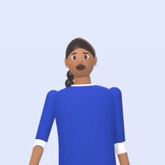

# SignSense 2.0

**Video calls with Indian Sign Language (ISL) assistance — for Deaf people talking with family who don't sign.**

Signs become words. Words become signs. Everything runs in the browser.


[**Features**](#-what-it-does) · [**Screenshots**](#-take-a-look) · [**How it works**](#-how-it-works) · [**Results**](#-measured-results) · [**Run it**](#-run-it-locally) · [**Tests**](#-tests) · [**Limits**](#-honest-limits)

</div>

---

## ✨ What it does

<table>
<tr>
<td width="50%" valign="top">

### ✋ Sign → text + speech
The signer's browser recognises **39 ISL signs** from the webcam (MediaPipe landmarks → a small neural network,
on-device). Confident signs are sent after a cancellable countdown, **unsure ones ask the signer to pick**, and
signs it doesn't know are **rejected instead of guessed**. The other person sees the word and can hear it read
aloud.

</td>
<td width="50%" valign="top">

### 🧍‍♀️ Text / speech → signs, by Saathi
**Saathi** is SignSense's signing guide — a rigged **3D character rendered live in the call**. When a sign arrives,
she performs it; when someone types or speaks, she signs each word that has a sign (others stay as text — never a
made-up sign). Replay and 0.5× speed for learners.

</td>
</tr>
<tr>
<td valign="top">

### 🖼️ Picture board
One-tap pictures — water, food, toilet, pain, help, yes/no — so the core conversation never needs reading or
signing.

</td>
<td valign="top">

### 🔒 Private by design
Video and audio go **peer-to-peer**; recognition runs **on the device**. The server only handles accounts,
meeting codes and connecting the call. No video is ever uploaded or stored.

</td>
</tr>
<tr>
<td valign="top">

### ⭐ My signs
Record your own signs (family names, home signs) before a call; in a call they're offered as
*"Is this your sign?"* — never sent without a tap. Only landmarks are stored, never video.

</td>
<td valign="top">

### 📖 Dictionary & practice
Watch Saathi sign all 39 words, type a sentence to see it signed, and practise at your webcam to see what the
recogniser understands — no account needed.

</td>
</tr>
</table>

<div align="center">

**Saathi signing "Thank you · Doctor · Medicine"** &nbsp;·&nbsp; **Happy · Family · How are you · Sick**

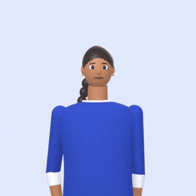
&nbsp;
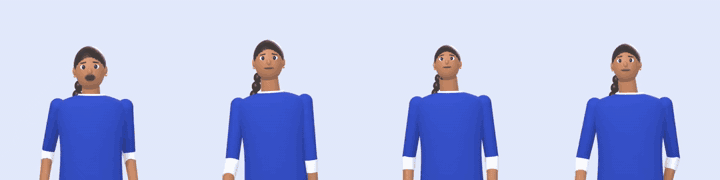

</div>

---

## 📸 Take a look

### Saathi in a live call
When the signer signs **Hello**, the other person sees the caption, hears it (optional), and Saathi performs the sign.

<p align="center">
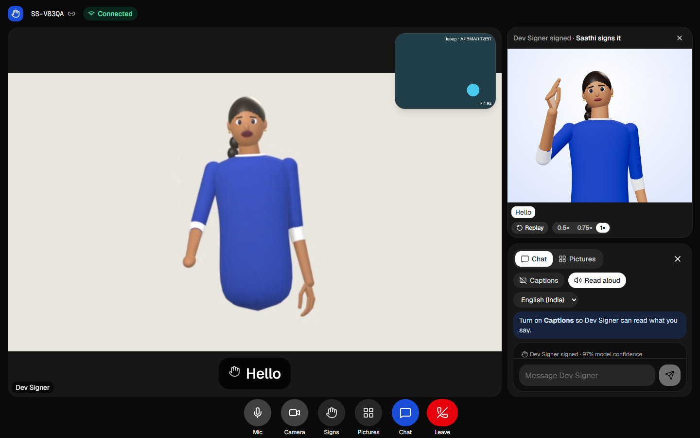
&nbsp;
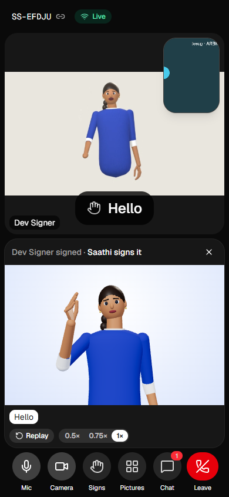
</p>

### The website

| Landing | Dashboard |
|---|---|
| 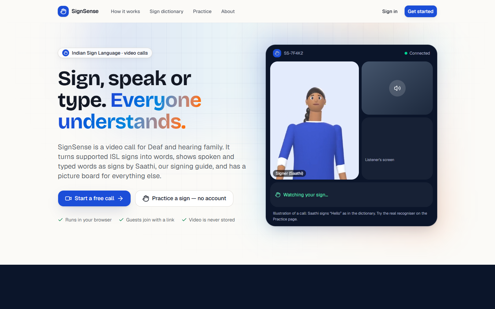 | 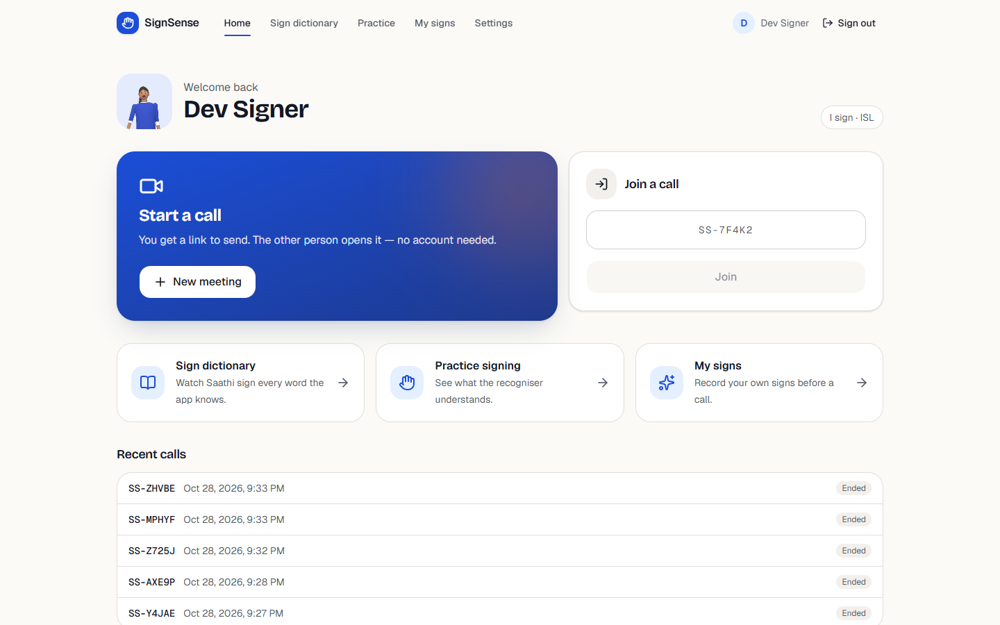 |
| **Sign dictionary** — Saathi signs every word, 3D or 2D | **Practice** — sign at the camera, or watch Saathi first |
| 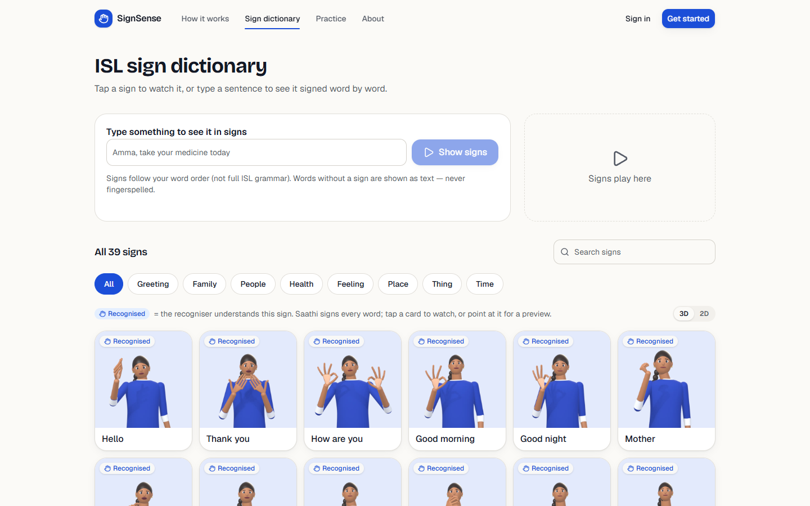 | 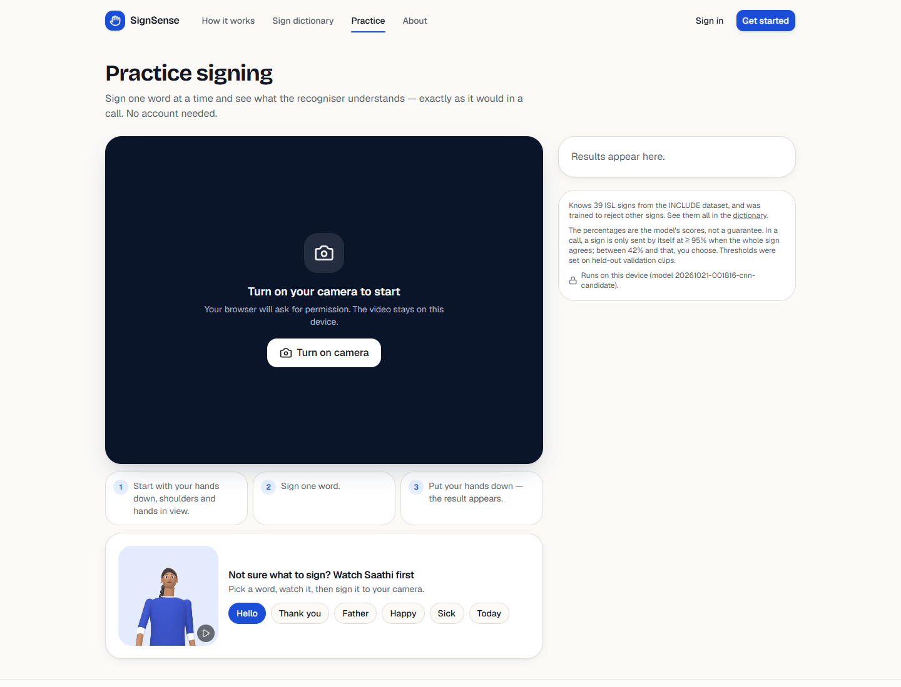 |
| **Recognition in a call** — confident signs send after a countdown | **Onboarding** — calls open with the right tools |
| 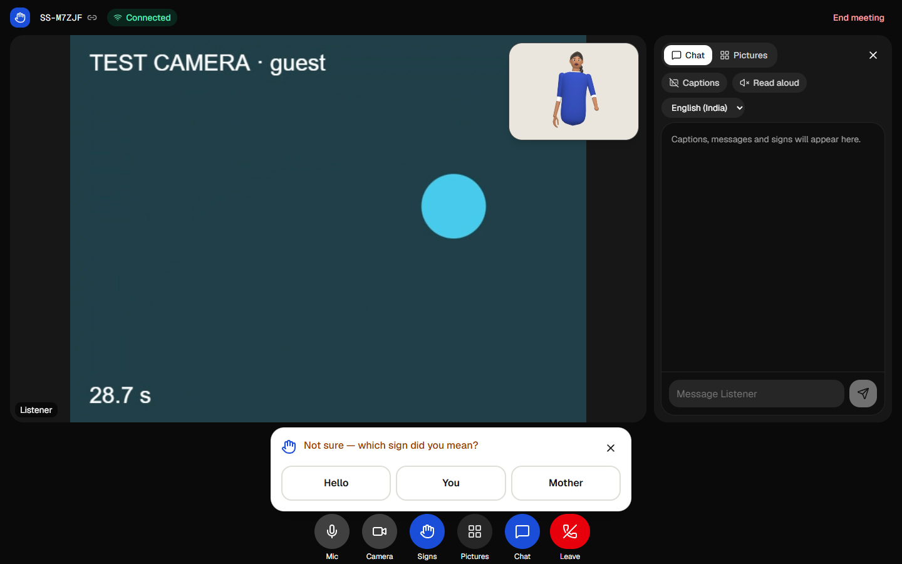 | 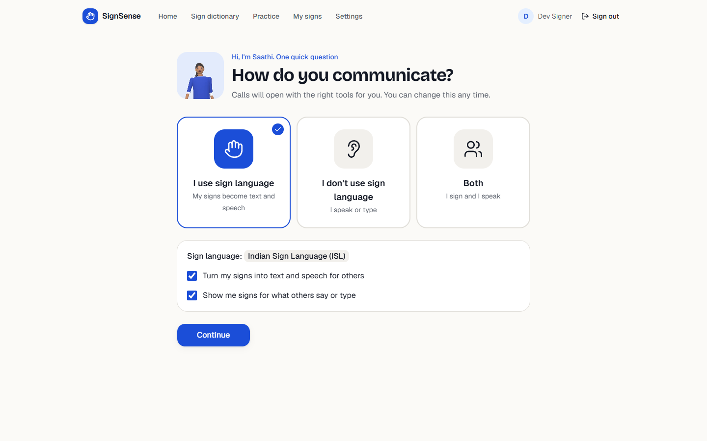 |

<details>
<summary><b>📱 Phone screens</b> (click to open)</summary>
<br/>

| Landing | Dictionary | Call chat | Picture board | My signs |
|---|---|---|---|---|
| 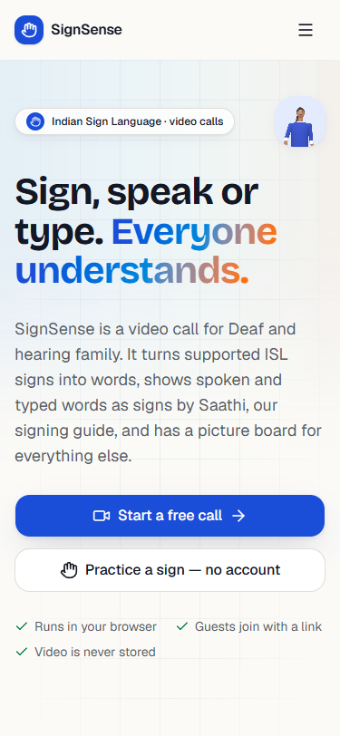 | 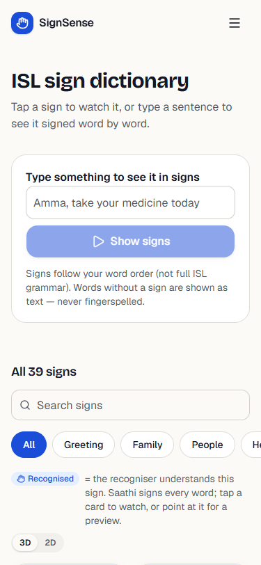 | 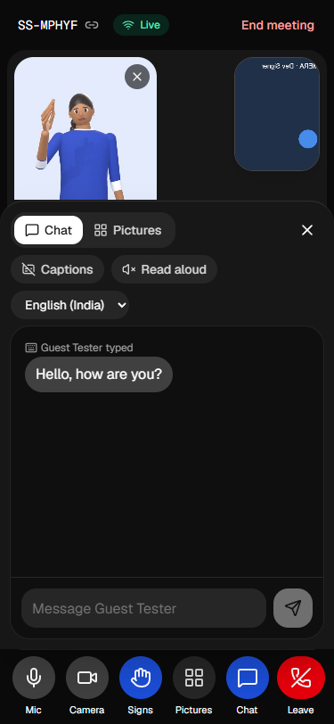 | 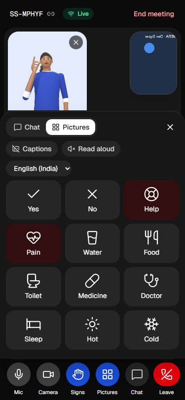 | 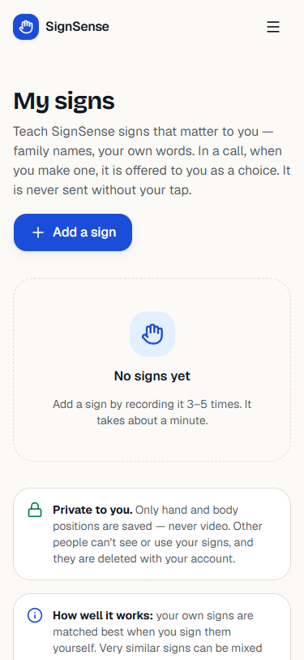 |

</details>

<details>
<summary><b>🧍‍♀️ All 39 signs Saathi knows</b> (click to open)</summary>
<br/>

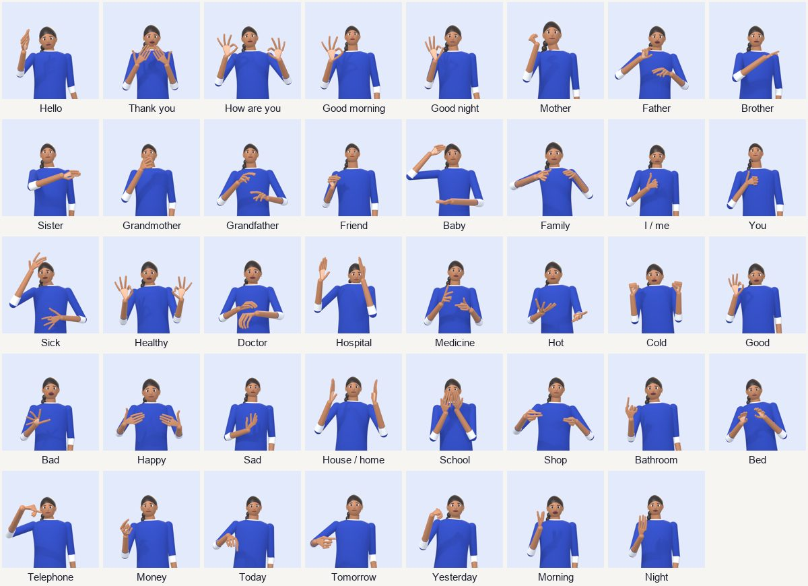

Choose how Saathi looks in **Settings**:

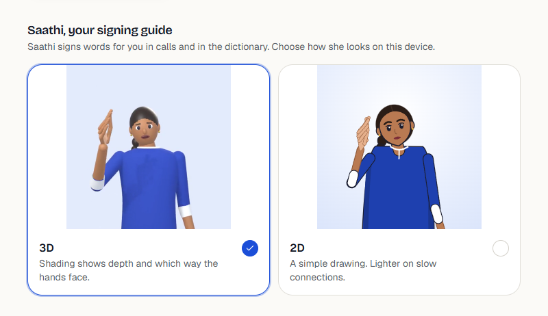

</details>

---

## 🧩 How it works

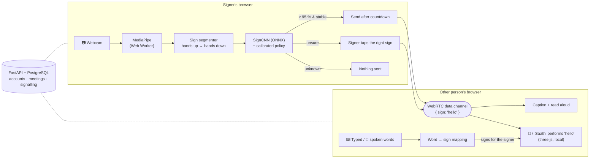

<details>
<summary><b>Under the hood</b></summary>
<br/>

- **Calls:** WebRTC 1:1 (audio, video, data channel) with WebSocket signalling in FastAPI; reconnects after network
  drops; optional TURN with short-lived credentials.
- **Recognition:** MediaPipe hand/pose/face landmarks in a Web Worker → 333 features × 48 frames → SignCNN
  (876 k parameters, 3.5 MB ONNX, ~10 ms per decision) with an `unknown` class trained on real unsupported ISL
  signs, temperature calibration and accept / suggest / reject thresholds chosen on validation data.
- **Saathi:** motion taken from the INCLUDE recordings (landmarks only) → 2D drawing (SVG), pre-rendered 3D videos
  (Blender, GPU) and a **rigged GLB** (skeleton with independent fingers, wrists, elbows, shoulders, head, brows,
  eyes, mouth; one animation clip per sign) rendered live with three.js / React Three Fiber. Details:
  [`docs/SAATHI_3D_LIVE.md`](docs/SAATHI_3D_LIVE.md).
- **Stack:** Next.js 16 · React 19 · TypeScript · Tailwind 4 · shadcn/ui · FastAPI · SQLAlchemy 2 (async) · Alembic ·
  PostgreSQL 17 · PyTorch · ONNX Runtime Web · MediaPipe Tasks · three.js · Blender 4.5.

| Folder | What |
|---|---|
| `frontend/` | The app: calls, recognition, Saathi, dictionary, practice |
| `backend/` | Auth, meetings, WebSocket signalling, personal signs |
| `ml/` | Data pipeline, training, evaluation, ONNX export, Blender scripts for Saathi |
| `sign-library/` | Saathi's motions, 3D videos and rigged model for 39 signs (+ attribution) |
| `docs/` | Design system, live recognition, Saathi, deployment, development log, project report |

</details>

---

## 📊 Measured results

Published model on INCLUDE data (39 signs + `unknown`). Full tables: [`docs/DEVELOPMENT_LOG.md`](docs/DEVELOPMENT_LOG.md).

| | Official test split | Held-out recording sessions *(stricter)* |
|---|---|---|
| Right sign (top-1 / top-3) | 96.7 % / 99.2 % | 86.4 % / 94.5 % |
| Supported signs sent as a **wrong** word | 0 / 121 | 0 / 110 |
| Unsupported signs sent as a word | 7 / 141 (5 %) | 0 / 141 |

**Can the recogniser read Saathi?** Each animation rendered and fed back through the same pipeline:

| | Right sign first | Sent automatically | Wrong word sent |
|---|---|---|---|
| Live 3D rig (in calls) | 35 / 39 | 17 | 0 |
| Original recordings (upper bound) | 39 / 39 | 34 | 0 |

---

## 🚀 Run it locally

<details>
<summary><b>Windows · Node 20+ · Python 3.11 · PostgreSQL 17 · Chrome or Edge</b> (click to open)</summary>
<br/>

```bash
# backend — one-time setup
cd backend
python -m venv .venv
.venv/Scripts/python -m pip install -r requirements-dev.txt
cp .env.example .env                 # set your Postgres password + JWT_SECRET
.venv/Scripts/alembic upgrade head
.venv/Scripts/uvicorn app.main:app --reload --port 8000
```

```bash
# frontend (second terminal)
cd frontend
npm install
npm run setup:runtime    # MediaPipe + ONNX Runtime WASM, landmark models, Saathi assets -> public/
npm run dev
```

Open http://localhost:3000. To try a call alone, open it in a normal **and** an incognito window.

**Phone on the same Wi-Fi** (camera needs HTTPS): `backend/.venv/Scripts/python scripts/make_dev_cert.py`, add
`CORS_ORIGIN_REGEX` to `backend/.env`, run the backend with `--host 0.0.0.0 --ssl-keyfile ../certs/dev-key.pem
--ssl-certfile ../certs/dev-cert.pem` and the frontend with `npm run dev:https`.

**Docker:** `cp .env.docker.example .env` then `docker compose up --build` (written, not yet run).

**Across networks:** set `TURN_URLS` + `TURN_SECRET` for a coturn server (none set up yet).

</details>

<details>
<summary><b>Rebuild the model or Saathi</b></summary>
<br/>

```bash
cd ml && .venv/Scripts/python -m signsense_ml.pipeline --download   # data → landmarks → train → evaluate → publish gate
cd ml && .venv/Scripts/python tools/build_sign_animations.py         # Saathi motion from the recordings
blender -b --factory-startup -P ml/blender/saathi_rig.py             # rigged 3D Saathi (39 clips, ~15 s)
cd ml && .venv/Scripts/python tools/render_saathi3d.py               # pre-rendered 3D videos (GPU)
cd frontend && npm run setup:runtime                                 # copy into the app
```

</details>

---

## 🧪 Tests

<details>
<summary><b>Unit, contract and browser checks</b> (click to open)</summary>
<br/>

```bash
cd backend && .venv/Scripts/python -m pytest     # API, auth, meetings, signalling, personal signs
cd ml && .venv/Scripts/python -m pytest          # features, decision policy, publish rule, Saathi motion
cd frontend && npm run test:signs                # segmenter, text→sign, policy, model in ORT-web, Saathi rig
cd frontend && npx tsc --noEmit && npm run lint && npm run build
# browser checks (dev servers running; headless Chrome, recorded clips as the camera):
cd frontend && npm run check:recognition         # live calls: recognition → confirmation → delivery
cd frontend && npm run check:saathi-call         # live 3D Saathi in calls, fallbacks, layout
cd frontend && npm run check:journeys            # first-time-user journeys and dead links
cd frontend && npm run check:ui                  # every page at 4 sizes, no overflow or clipped content
```

Browser checks need local test accounts: copy `backend/seed/dev_users.example.json` to `dev_users.json`.

</details>

---

## 🚧 Honest limits

- **39 single signs**, word by word — not continuous signing and not ISL grammar.
- Tested on **recordings**, not yet with new people at real webcams; INCLUDE has no signer IDs, so no evaluation
  is truly signer-independent.
- Saathi's signs are copied from one recording each and have **not yet been reviewed by Deaf signers**.
- 1:1 calls only; no TURN server or deployment yet.

---

## 🙏 Credits

Training data and Saathi's sign movements: **INCLUDE** — Sridhar, Ganesan, Kumar, Khapra, ACM MM 2020,
[zenodo.org/records/4010759](https://zenodo.org/records/4010759) (CC BY 4.0), signed by Deaf students of
St. Louis School for the Deaf, Chennai. Official split from AI4Bharat/INCLUDE (MIT). Landmarks: Google MediaPipe
(Apache-2.0). Inference: ONNX Runtime Web (MIT). 3D: three.js (MIT), React Three Fiber (MIT), Blender.
